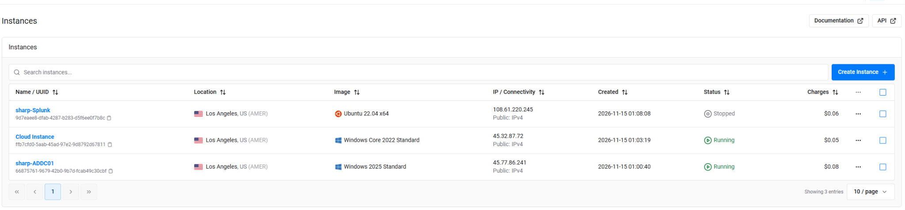

# Active Directory 2.0 — SOC Automation & Incident Response

A hands-on cybersecurity project focused on building a simulated enterprise SOC environment using Active Directory, Splunk SIEM, Shuffle SOAR, and Slack for threat detection and automated incident response.

---

## Part 1: Project Overview & Architecture

### Project Overview

In this project, I'm building an Active Directory environment to simulate real-world cyberattacks, monitor suspicious authentication activity, and automate security responses.

The goal is to understand how different security technologies work together in a SOC environment, from collecting security logs to detecting threats and responding to potential account compromises.

### 🖥️ Lab Architecture

The environment consists of three virtual machines hosted on Vultr:

| Virtual Machine | Operating System | Purpose |
|---|---|---|
| Domain Controller | Windows Server 2025 | Manages Active Directory users, accounts, and authentication |
| Splunk Server | Ubuntu Server 22.04 | Collects and analyzes security logs |
| Test Machine | Windows Server 2022 Core | Simulates an endpoint targeted by attackers |

### 🔄 Planned Security Workflow

The project is designed to follow this incident response process:

1. **Attack Simulation:** An attacker attempts to authenticate to the Windows test machine.
2. **Log Collection:** Authentication activity is forwarded to Splunk for monitoring.
3. **Threat Detection:** Splunk identifies suspicious activity and generates a security alert.
4. **SOAR Automation:** The alert triggers a Shuffle SOAR playbook and sends a notification to Slack.
5. **Analyst Review:** Shuffle notifies a SOC analyst, who determines whether the affected account should be disabled.
6. **Incident Response:** If approved, the domain account is disabled and a confirmation is sent to Slack. Otherwise, no automated remediation occurs.

### 🎯 Project Objectives

Through this project, I aim to develop hands-on experience with:

- **Active Directory:** Identity and access management
- **Splunk SIEM:** Security monitoring and threat detection
- **Shuffle SOAR:** Security orchestration and automated incident response
- **Slack:** Security alert notifications
- **Windows Security Logs:** Authentication monitoring and investigation
- **Cloud Networking:** Virtual machine deployment, firewall configuration, and private networking

### Part 1 Summary

This phase focused on understanding the overall architecture, identifying the required technologies, and planning how the different systems will communicate.

The next phase involves deploying and configuring the infrastructure needed to support the environment.

---

## Part 2: Cloud Infrastructure & Network Configuration

### Overview

In this phase, I deployed the virtual machines on Vultr, configured firewall rules to restrict remote access, established private networking, and troubleshot connectivity issues between the servers.

The objective was to prepare a functioning cloud environment before installing Active Directory and integrating the security monitoring tools.

### Step 1: Deploying the Virtual Machines

I started by deploying three virtual machines in Vultr's **Los Angeles region**.

Each server was assigned a specific role within the environment:

- **Windows Server 2025:** Future Active Directory Domain Controller
- **Windows Server 2022 Core:** Windows Test Machine
- **Ubuntu Server 22.04:** Future Splunk SIEM Server

Deploying the servers in the same region allowed me to configure private network communication between them.

### Step 2: Configuring Firewall Security

After deploying the servers, I created a Vultr firewall group named `sharp-AD-Project-2.0` to restrict inbound network traffic.

I configured the following rules:

- **SSH (Port 22):** Allowed remote administrative access from my public IP address.
- **RDP (Port 3389):** Allowed Remote Desktop connections from my public IP address.
- **Default Deny:** Blocked all other inbound traffic not explicitly permitted.

Restricting administrative access to my public IP helped reduce unnecessary exposure to external connections.

I then configured the firewall group on the Windows instances.

### Step 3: Establishing Remote Access

With the firewall configuration in place, I connected to the Windows servers using Remote Desktop Protocol (RDP).

This allowed me to access the Windows environments and begin configuring their network settings remotely.

### Step 4: Configuring Private VPC Networking

Next, I configured Vultr's **Virtual Private Cloud (VPC)** networking to allow the virtual machines to communicate using private IP addresses rather than relying on their public interfaces.

The private network provides a dedicated communication path between the servers for internal services and security monitoring.

I verified the VPC configuration and network interface assignments.

I also manually configured static IPv4 settings on the secondary network adapters of the Windows servers to align with the VPC subnet.

### Step 5: Troubleshooting Network Connectivity

After configuring the private network, I tested communication between the servers using the `ping` command from the Ubuntu server.

Initially, the tests failed with **Destination Host Unreachable** messages and packet loss.

This indicated that the private network communication was not functioning correctly.

I reviewed the network configuration, corrected the private IP settings, and repeated the connectivity tests.

After making the necessary adjustments, the Ubuntu server successfully received ICMP replies from the Windows servers over their private IP addresses.

This confirmed that basic private network connectivity was working between the machines.

### ✅ Part 2: Results

By the end of this phase, I had:

- Deployed three virtual machines in Vultr's Los Angeles region.
- Configured firewall rules to restrict administrative access.
- Established remote access to the Windows servers.
- Configured private VPC networking.
- Assigned static private IP addresses to the Windows network interfaces.
- Troubleshot and resolved network connectivity issues.
- Successfully verified communication between the servers.
