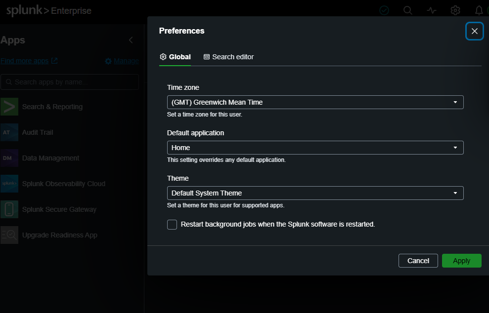
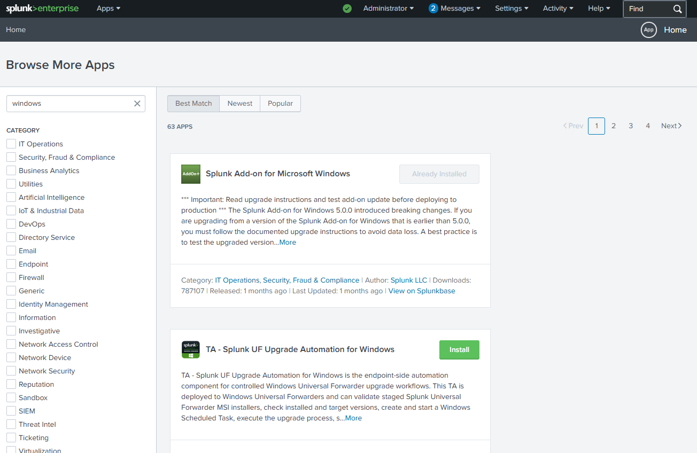
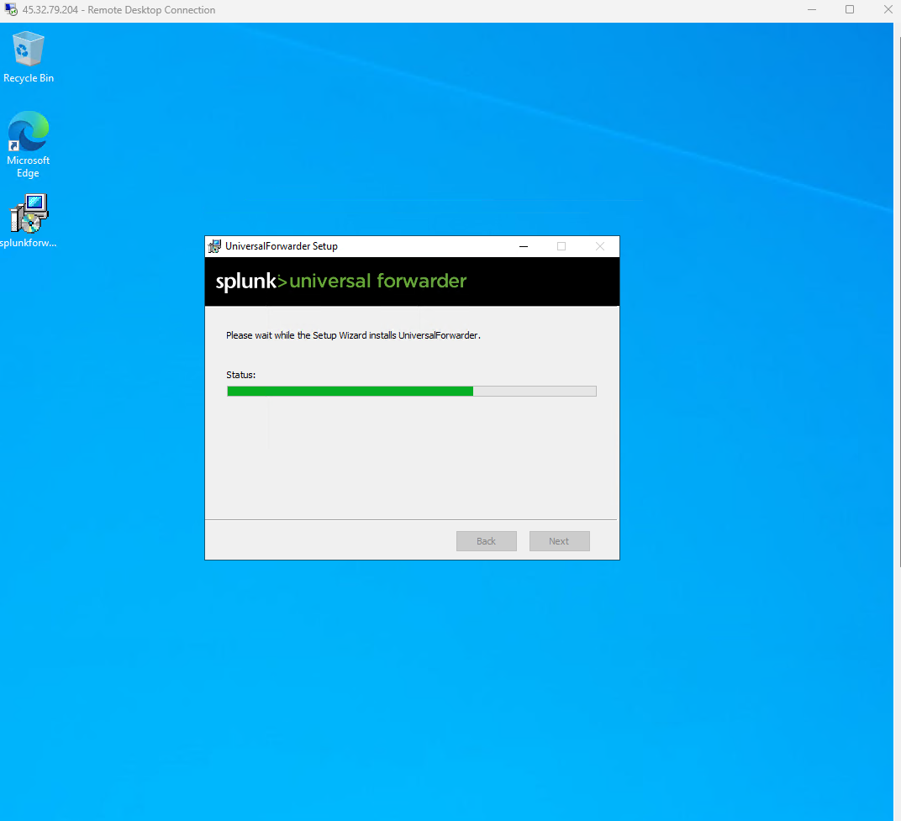
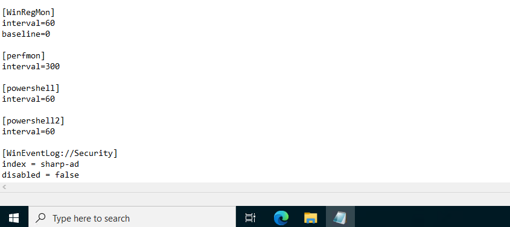

# Active Directory 2.0 — SOC Automation & Incident Response

A hands-on cybersecurity project focused on building a simulated enterprise SOC environment using Active Directory, Splunk SIEM, Shuffle SOAR, and Slack for threat detection and automated incident response.


---

## Part 1: Project Overview & Architecture

### Project Overview

In this project, I'm building an Active Directory environment to simulate real-world cyberattacks, monitor suspicious authentication activity, and automate security responses.

The goal is to understand how different security technologies work together in a SOC environment, from collecting security logs to detecting threats and responding to potential account compromises.

### 🖥️ Lab Architecture

The environment consists of three virtual machines hosted on Vultr:

| Virtual Machine | Operating System | Purpose |
|---|---|---|
| Domain Controller (`sharp-ADDC01`) | Windows Server 2025 Standard | Planned Active Directory users, accounts, and authentication management |
| Splunk Server (`sharp-Splunk`) | Ubuntu Server 22.04 | Planned security log collection and analysis |
| Test Machine | Windows Server 2022 Core | Simulated endpoint for testing |

### 🔄 Planned Security Workflow

The project is designed to follow this incident response process:

1. **Attack Simulation:** An attacker attempts to authenticate to the Windows test machine.
2. **Log Collection:** Authentication activity is forwarded to Splunk for monitoring.
3. **Threat Detection:** Splunk identifies suspicious activity and generates a security alert.
4. **SOAR Automation:** The alert triggers a Shuffle SOAR playbook and sends a notification to Slack.
5. **Analyst Review:** Shuffle notifies a SOC analyst, who determines whether the affected account should be disabled.
6. **Incident Response:** If approved, the domain account is disabled and a confirmation is sent to Slack. Otherwise, no automated remediation occurs.

### 🎯 Project Objectives

Through this project, I aim to develop hands-on experience with:

- **Active Directory:** Identity and access management
- **Splunk SIEM:** Security monitoring and threat detection
- **Shuffle SOAR:** Security orchestration and automated incident response
- **Slack:** Security alert notifications
- **Windows Security Logs:** Authentication monitoring and investigation
- **Cloud Networking:** Virtual machine deployment, firewall configuration, and private networking

### Part 1 Summary

This phase focused on understanding the overall architecture, identifying the required technologies, and planning how the different systems will communicate.

The next phase involves deploying and configuring the infrastructure needed to support the environment.

---

## Part 2: Cloud Infrastructure & Network Configuration

### Overview

In this phase, I deployed virtual machines on Vultr, configured firewall rules for remote access, established private networking, and troubleshot connectivity issues between the servers.

The objective was to prepare a functioning cloud environment before configuring Active Directory and integrating the security monitoring tools.

### Step 1: Deploying the Virtual Machines

I deployed three virtual machines in Vultr's **Los Angeles region**:

- **Windows Server 2025 Standard:** Future Active Directory Domain Controller (`sharp-ADDC01`)
- **Windows Server 2022 Core:** Windows Test Machine
- **Ubuntu Server 22.04:** Future Splunk SIEM Server (`sharp-Splunk`)

The instance dashboard shows all three machines and their operating systems. It also captures their running or stopped status at that point in the deployment.


### Step 2: Configuring Firewall Security

I created a Vultr firewall group named `sharp-AD-Project-2.0` to restrict administrative access. The configured inbound rules shown in the screenshot allow SSH (port 22) and RDP (port 3389) from a specified `/32` public IP, with a default deny rule for other inbound traffic.


I then checked the firewall group selection on the intended Domain Controller instance.


I also reviewed the firewall group selection on the Windows test machine.


**Note:** The firewall rule screenshot shows **zero attached instances** at that moment, while the instance settings screenshots show firewall groups selected. These screenshots document configuration steps at different times; they do not, by themselves, prove the rules were active on both machines simultaneously.

### Step 3: Establishing Remote Access

I accessed the Windows server through Remote Desktop Protocol (RDP) to perform configuration directly inside the operating system.

The following screenshot shows the established Windows desktop session.


### Step 4: Configuring Private VPC Networking

I configured a Vultr VPC connection for internal communication between the servers, reducing the need to use public IP addresses for server-to-server traffic.

The Windows instance's VPC settings show its assigned private address and network details.


I also checked the Ubuntu server's public IPv4 configuration while reviewing its network connectivity. **This screenshot shows its public network settings, not its VPC address.**


On the Windows test machine, I opened the secondary adapter's IPv4 properties and manually entered a private address and subnet mask for the VPC network.


### Step 5: Troubleshooting Network Connectivity

I tested connectivity from the Ubuntu server using `ping`. The initial attempts to reach the Windows test machine's private address returned **Destination Host Unreachable** messages. A separate public-address test also showed packet loss.

After adjusting the network configuration, the same terminal session showed successful ICMP replies from the previously unreachable private address.


I then ran another ping test to the other Windows server's private address and received successful ICMP replies.


These tests confirmed basic ICMP reachability to the two private targets shown. Additional service-level checks will be needed when Active Directory and Splunk are configured.

### ✅ Part 2: Results

By the end of this phase, I had:

- Deployed three Vultr instances in the Los Angeles region.
- Created firewall rules limiting SSH and RDP access to a specified source IP.
- Accessed a Windows server through RDP.
- Attached and configured private VPC networking on the Windows environment.
- Configured a static private IPv4 address on a Windows network adapter.
- Troubleshot failed ICMP connectivity tests.
- Verified successful ICMP replies to two Windows private IP addresses from Ubuntu.

---

## Part 3: Active Directory Deployment & Remote Access Configuration

### Overview

In this phase, I configured Active Directory Domain Services (AD DS), established a new Active Directory forest, and began integrating the Windows test machine into the domain environment.

I also investigated a Remote Desktop authentication issue involving a domain user account and configured the appropriate remote access permissions.

### Step 1: Installing Active Directory Domain Services

I accessed the Windows Server through the Vultr console and opened Server Manager.

Using the **Add Roles and Features Wizard**, I selected the **Active Directory Domain Services (AD DS)** server role.

AD DS provides centralized identity management, authentication, and access control for Windows domain environments.


### Step 2: Promoting the Server to a Domain Controller

After installing the AD DS role, I launched the Active Directory Domain Services Configuration Wizard.

Because this was a new environment, I selected **Add a new forest** and configured the following root domain:

- **Root domain:** `sharp.local`
- **Deployment type:** New Active Directory forest
- **Server role:** Domain Controller

This establishes the foundation for centralized authentication and domain management.


### Step 3: Verifying the Active Directory Domain

After the domain configuration, I opened **Active Directory Users and Computers (ADUC)** to verify that the new domain was available.

The console displayed `sharp.local` and its default Active Directory containers, including:

- Builtin
- Computers
- Domain Controllers
- ForeignSecurityPrincipals
- Managed Service Accounts
- Users

This confirmed that the Active Directory domain was accessible through the management console.


### Step 4: Preparing the Windows Test Machine

Next, I accessed the Windows test machine to prepare it for integration with the Active Directory environment.

I opened **System Properties** to review its computer name and current workgroup membership.

The screenshot captures the machine before its domain membership was verified.

For domain integration, the test machine must use DNS capable of resolving the `sharp.local` Active Directory domain, typically through the Domain Controller's DNS service.


### Step 5: Troubleshooting Remote Desktop Authentication

While attempting to connect to the Windows test machine using the domain user account `SHARP\JSmith`, I encountered the following error:

> The connection was denied because the user account is not authorized for remote login.

This indicated that the attempted account did not have the necessary Remote Desktop logon authorization on the target system.

The error was related to remote logon permissions rather than establishing that the account password was incorrect.


### Step 6: Configuring Remote Desktop User Permissions

To address the authorization issue, I opened the Windows **System Properties** Remote settings and accessed the **Remote Desktop Users** configuration.

From the domain location `sharp.local`, I selected the account **Jenny Smith (`JSmith`)** for inclusion in the permitted Remote Desktop users.

This step was intended to grant the domain account permission to establish an RDP session on the test machine.


The screenshot documents the user selection process. A successful login test is still needed to confirm that the permission change took effect.

### Part 3: Results

During this phase, I:

- Selected and installed the Active Directory Domain Services role.
- Configured a new Active Directory forest named `sharp.local`.
- Verified the domain through Active Directory Users and Computers.
- Reviewed the Windows test machine's computer and domain settings.
- Investigated a domain-user Remote Desktop authorization error.
- Configured the domain user selection for Remote Desktop access.

---

## Part 4: Splunk SIEM Deployment & Windows Event Log Integration

### Overview

In this phase, I deployed Splunk Enterprise on the Ubuntu server, configured the Windows endpoints to forward security events, and verified that logs from the lab were searchable in a centralized SIEM.

I also troubleshot an incorrect forwarding destination on the Domain Controller. During the Universal Forwarder setup, I initially entered the Domain Controller's VPC address instead of the Splunk server's private IP address. After correcting the destination and restarting the forwarder, I verified ingestion from both Windows hosts.

### Step 1: Preparing the Ubuntu Splunk Server

I accessed the Ubuntu-based Splunk server and prepared the operating system for installation. I created a simple Bash script for package maintenance:

```bash
#!/bin/bash
sudo apt update -y && sudo apt upgrade -y
```

The screenshot shows the script contents; it does not independently confirm its execution.


### Step 2: Downloading and Installing Splunk Enterprise

I downloaded the Splunk Enterprise 10.6.1 Debian package from Splunk's official download server using `wget`.


The installation workflow used the downloaded `.deb` package with `dpkg`, followed by management of the Splunk installation under `/opt/splunk/bin`.

```bash
sudo dpkg -i splunk-10.6.1.1-b2ae2962645c-linux-amd64.deb
sudo /opt/splunk/bin/splunk start --accept-license
```

The following screenshot shows the Splunk executable directory, providing evidence of the installation files. The later web interface screenshots confirm Splunk Enterprise was running.


### Step 3: Configuring Splunk Web Access on Port 8000

Splunk Web uses TCP port **8000** by default. I worked on configuring access through both the Vultr cloud firewall and the Ubuntu host firewall.

The Vultr screenshot shows a proposed inbound TCP rule for port 8000. The source field was not accepted in that screenshot, so it does not prove that the cloud rule was saved.


On Ubuntu, I added a local UFW rule:

```bash
sudo ufw allow 8000
```

The terminal confirmed that IPv4 and IPv6 rules were added. For a hardened deployment, access to the web interface should be restricted to a trusted administrative IP rather than the entire internet.



### Step 4: Configuring the Splunk Web Interface

After accessing Splunk Enterprise, I reviewed the administrator preferences and selected the GMT time zone for the Splunk user interface.



I also verified that the **Splunk Add-on for Microsoft Windows** was installed. This add-on provides Windows-specific field extraction and event normalization capabilities.


### Step 5: Enabling Forwarder Receiving on Port 9997

To accept data from Windows Universal Forwarders, I configured Splunk's receiving port as **9997/TCP**.



I also added the corresponding local Ubuntu firewall rule:

```bash
sudo ufw allow 9997
```

The terminal confirmed that the rule was added. In a production environment, I would restrict this port to the Windows endpoints' private IP addresses.


### Step 6: Installing the Splunk Universal Forwarder on Windows

I installed the **Splunk Universal Forwarder** on the Windows lab environment to collect Windows event logs and send them to the central Splunk instance.

The installation screenshot shows the setup process on a Windows endpoint.


The forwarder stores local configuration files in:

```text
C:\Program Files\SplunkUniversalForwarder\etc\system\local\
```



### Step 7: Configuring Windows Security Log Collection

I configured an `inputs.conf` file to collect the Windows Security event log and associate it with my custom index, **`sharp-ad`**.

```ini
[WinEventLog://Security]
index = sharp-ad
disabled = false
```


This configuration targets authentication and other security-related events recorded in the Windows Security log.

### Step 8: Reviewing the Forwarder Service Account

I opened Windows Services and reviewed the **SplunkForwarder** service's Log On configuration. The screenshot shows the account `NT SERVICE\SplunkForwarder` selected.


The account used by the service must have sufficient permissions to read the event logs being collected. The screenshot documents the service settings, not a confirmed change to Local System.

### Step 9: Investigating Missing Events

I searched the custom index using:

```spl
index=sharp-ad
```

Initially, the search returned **0 events**, showing that the pipeline was not yet producing searchable data in the selected time range.


After further configuration, the same index began returning results. A subsequent screenshot showed **1,054 events**, including Windows Security event codes such as 4634, 4672, 4624, and 4648.


### Step 10: Correcting the Domain Controller's Forwarding Destination

While configuring the Universal Forwarder on my Domain Controller, I made a networking mistake: I entered the **Domain Controller's own VPC IP address** as the destination instead of the **Splunk server's private IP address**.

The Universal Forwarder must send event data to the Splunk receiving server, not back to the Windows machine generating the events.

The setup screenshot shows the Domain Controller forwarder configuration and a private address entered in the optional **Deployment Server** field.


**Important distinction:** A deployment server on port 8089 is not the same as an indexer receiving forwarded events on port 9997. Since this lab used a receiving Splunk server, I needed to verify the forwarding destination in `outputs.conf`, rather than rely on the optional deployment-server field.

The corrected forwarding target should follow this structure:

```ini
[tcpout]
defaultGroup = primary_indexers

[tcpout:primary_indexers]
server = <SPLUNK_PRIVATE_IP>:9997
```

After correcting the destination, I restarted the SplunkForwarder service so the updated configuration could take effect. The exact correction command is not visible in the supplied screenshots, so I have not represented one as an executed command.

I also reviewed the Domain Controller's local forwarder configuration files, including `inputs.conf`.


### Step 11: Verifying Events from Both Windows Hosts

I repeated the Splunk search:

```spl
index=sharp-ad
```

The search returned **1,208 events**. More importantly, the host field contained **two distinct sources**:

| Host | Events | Share |
|---|---:|---:|
| `vultr-guest` | 1,080 | 89.404% |
| `sharp-ADDC01` | 128 | 10.596% |

This confirmed that events from both Windows hosts were being indexed in Splunk.


### Step 12: Researching Windows Authentication Events

With telemetry arriving, I began reviewing Windows Security Event ID **4624**, which records successful logon activity.


I also reviewed Windows logon types to distinguish interactive, network, and remote sessions.


Relevant logon types include:

- **2 — Interactive:** Local keyboard or console sign-in.
- **3 — Network:** Network-based access to a resource.
- **7 — Unlock:** Unlocking a previously locked session.
- **10 — RemoteInteractive:** Remote Desktop or Terminal Services sign-in.

For RDP detection, **Logon Type 10** is the primary type to investigate. Type 7 represents an unlock, not a general network logon.

A starting search for successful RDP logons is:

```spl
index=sharp-ad EventCode=4624 Logon_Type=10
```

Depending on how the Windows events are parsed, the logon-type field may need to be adjusted to the field name present in the indexed data.

### Step 13: Filtering Successful Authentication Events

After reviewing Windows logon types, I searched the `sharp-ad` index for successful authentication events using Event ID **4624**:

```spl
index=sharp-ad EventCode=4624
```

The search returned **259 events** across the monitored Windows systems, confirming that successful authentication activity was available for investigation.


I then examined the details of an individual event associated with the `jsmith` account. The event showed **Logon Type 7**, indicating a workstation unlock rather than a new RDP session. This helped me distinguish authentication event categories before developing detection logic.


Next, I narrowed the search to successful authentication events with logon types **7 or 10**:

```spl
index=sharp-ad EventCode=4624 (Logon_Type=7 OR Logon_Type=10)
```

The refined query returned **9 events**, reducing the dataset to workstation unlocks and remote interactive logons for closer examination.


**Detection note:** Logon Type 7 represents a workstation unlock, while **Logon Type 10** represents RemoteInteractive access such as RDP. The next detection iteration will focus specifically on Type 10 and evaluate source IP addresses against approved administrative access patterns. The filtered results are not, by themselves, evidence of unauthorized access.

### Part 4: Results

During this phase, I:

- Downloaded and deployed Splunk Enterprise on Ubuntu.
- Configured local firewall access for Splunk Web and forwarder receiving.
- Accessed the Splunk Enterprise web interface.
- Verified installation of the Splunk Add-on for Microsoft Windows.
- Configured TCP port 9997 for forwarder ingestion.
- Installed and configured Windows Universal Forwarders.
- Configured Windows Security event log collection using `inputs.conf`.
- Troubleshot an incorrect Domain Controller forwarding destination.
- Verified successful ingestion into the `sharp-ad` index.
- Confirmed that both Windows hosts appeared in Splunk search results.
- Investigated Event ID 4624 and Windows logon types.
- Reduced 259 successful-logon events to 9 events matching logon types 7 or 10.
