# Active Directory 2.0 — SOC Automation & Incident Response

A hands-on cybersecurity project focused on building a simulated enterprise SOC environment using Active Directory, Splunk SIEM, Shuffle SOAR, and Slack for threat detection and automated incident response.


---

## Part 1: Project Overview & Architecture

### Project Overview

In this project, I'm building an Active Directory environment to simulate real-world cyberattacks, monitor suspicious authentication activity, and automate security responses.

The goal is to understand how different security technologies work together in a SOC environment, from collecting security logs to detecting threats and responding to potential account compromises.

### 🖥️ Lab Architecture

The environment consists of three virtual machines hosted on Vultr:

| Virtual Machine | Operating System | Purpose |
|---|---|---|
| Domain Controller (`sharp-ADDC01`) | Windows Server 2025 Standard | Planned Active Directory users, accounts, and authentication management |
| Splunk Server (`sharp-Splunk`) | Ubuntu Server 22.04 | Planned security log collection and analysis |
| Test Machine | Windows Server 2022 Core | Simulated endpoint for testing |

### 🔄 Planned Security Workflow

The project is designed to follow this incident response process:

1. **Attack Simulation:** An attacker attempts to authenticate to the Windows test machine.
2. **Log Collection:** Authentication activity is forwarded to Splunk for monitoring.
3. **Threat Detection:** Splunk identifies suspicious activity and generates a security alert.
4. **SOAR Automation:** The alert triggers a Shuffle SOAR playbook and sends a notification to Slack.
5. **Analyst Review:** Shuffle notifies a SOC analyst, who determines whether the affected account should be disabled.
6. **Incident Response:** If approved, the domain account is disabled and a confirmation is sent to Slack. Otherwise, no automated remediation occurs.

### 🎯 Project Objectives

Through this project, I aim to develop hands-on experience with:

- **Active Directory:** Identity and access management
- **Splunk SIEM:** Security monitoring and threat detection
- **Shuffle SOAR:** Security orchestration and automated incident response
- **Slack:** Security alert notifications
- **Windows Security Logs:** Authentication monitoring and investigation
- **Cloud Networking:** Virtual machine deployment, firewall configuration, and private networking

### Part 1 Summary

This phase focused on understanding the overall architecture, identifying the required technologies, and planning how the different systems will communicate.

The next phase involves deploying and configuring the infrastructure needed to support the environment.

---

## Part 2: Cloud Infrastructure & Network Configuration

### Overview

In this phase, I deployed virtual machines on Vultr, configured firewall rules for remote access, established private networking, and troubleshot connectivity issues between the servers.

The objective was to prepare a functioning cloud environment before configuring Active Directory and integrating the security monitoring tools.

### Step 1: Deploying the Virtual Machines

I deployed three virtual machines in Vultr's **Los Angeles region**:

- **Windows Server 2025 Standard:** Future Active Directory Domain Controller (`sharp-ADDC01`)
- **Windows Server 2022 Core:** Windows Test Machine
- **Ubuntu Server 22.04:** Future Splunk SIEM Server (`sharp-Splunk`)

The instance dashboard shows all three machines and their operating systems. It also captures their running or stopped status at that point in the deployment.


### Step 2: Configuring Firewall Security

I created a Vultr firewall group named `sharp-AD-Project-2.0` to restrict administrative access. The configured inbound rules shown in the screenshot allow SSH (port 22) and RDP (port 3389) from a specified `/32` public IP, with a default deny rule for other inbound traffic.

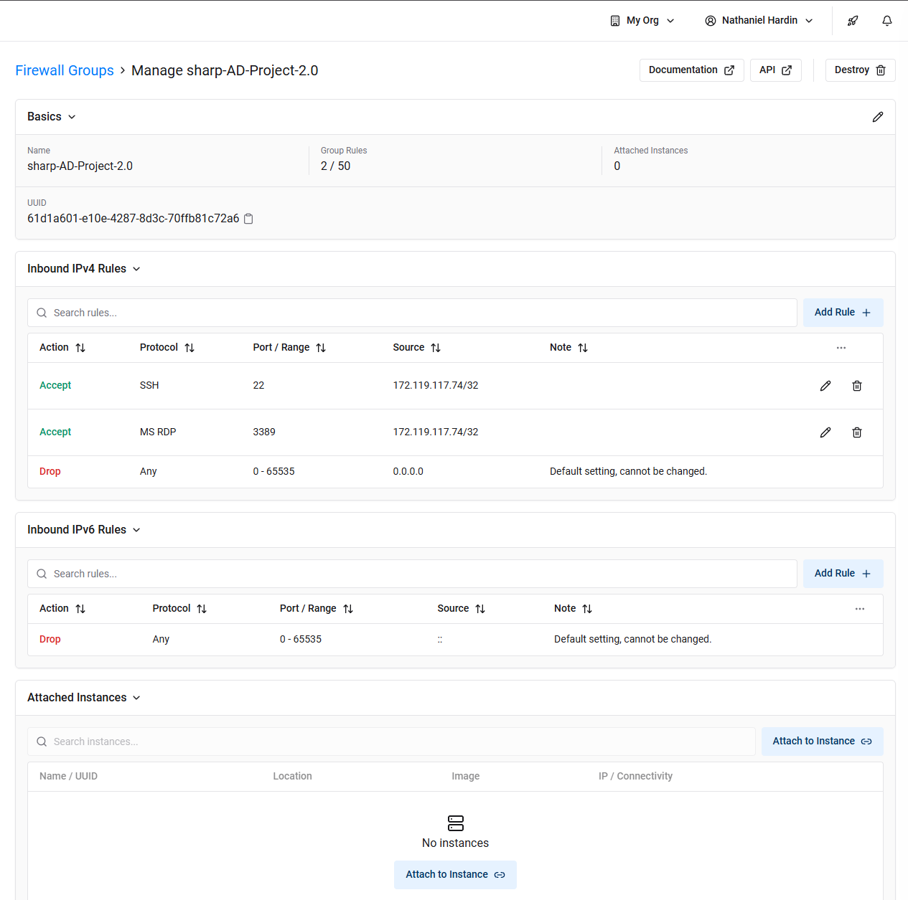

I then checked the firewall group selection on the intended Domain Controller instance.


I also reviewed the firewall group selection on the Windows test machine.


**Note:** The firewall rule screenshot shows **zero attached instances** at that moment, while the instance settings screenshots show firewall groups selected. These screenshots document configuration steps at different times; they do not, by themselves, prove the rules were active on both machines simultaneously.

### Step 3: Establishing Remote Access

I accessed the Windows server through Remote Desktop Protocol (RDP) to perform configuration directly inside the operating system.

The following screenshot shows the established Windows desktop session.


### Step 4: Configuring Private VPC Networking

I configured a Vultr VPC connection for internal communication between the servers, reducing the need to use public IP addresses for server-to-server traffic.

The Windows instance's VPC settings show its assigned private address and network details.


I also checked the Ubuntu server's public IPv4 configuration while reviewing its network connectivity. **This screenshot shows its public network settings, not its VPC address.**


On the Windows test machine, I opened the secondary adapter's IPv4 properties and manually entered a private address and subnet mask for the VPC network.


### Step 5: Troubleshooting Network Connectivity

I tested connectivity from the Ubuntu server using `ping`. The initial attempts to reach the Windows test machine's private address returned **Destination Host Unreachable** messages. A separate public-address test also showed packet loss.

After adjusting the network configuration, the same terminal session showed successful ICMP replies from the previously unreachable private address.

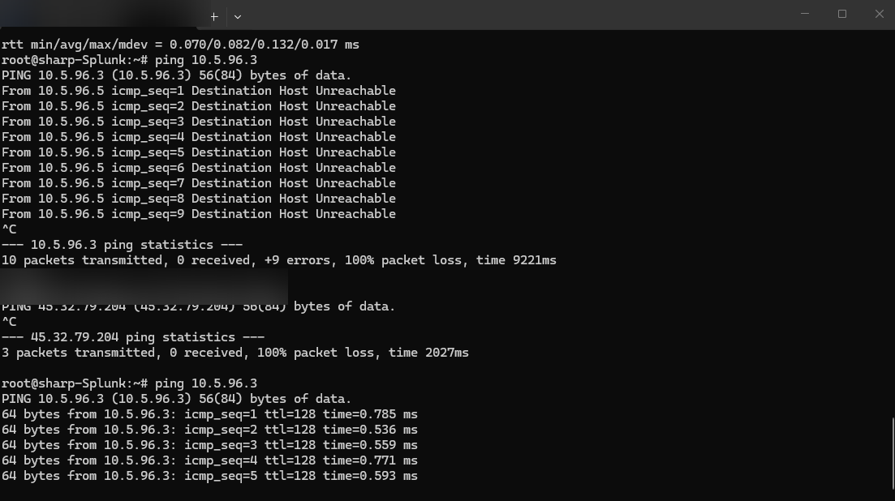

I then ran another ping test to the other Windows server's private address and received successful ICMP replies.


These tests confirmed basic ICMP reachability to the two private targets shown. Additional service-level checks will be needed when Active Directory and Splunk are configured.

### ✅ Part 2: Results

By the end of this phase, I had:

- Deployed three Vultr instances in the Los Angeles region.
- Created firewall rules limiting SSH and RDP access to a specified source IP.
- Accessed a Windows server through RDP.
- Attached and configured private VPC networking on the Windows environment.
- Configured a static private IPv4 address on a Windows network adapter.
- Troubleshot failed ICMP connectivity tests.
- Verified successful ICMP replies to two Windows private IP addresses from Ubuntu.

---

## Part 3: Active Directory Deployment & Remote Access Configuration

### Overview

In this phase, I configured Active Directory Domain Services (AD DS), established a new Active Directory forest, and began integrating the Windows test machine into the domain environment.

I also investigated a Remote Desktop authentication issue involving a domain user account and configured the appropriate remote access permissions.

### Step 1: Installing Active Directory Domain Services

I accessed the Windows Server through the Vultr console and opened Server Manager.

Using the **Add Roles and Features Wizard**, I selected the **Active Directory Domain Services (AD DS)** server role.

AD DS provides centralized identity management, authentication, and access control for Windows domain environments.


### Step 2: Promoting the Server to a Domain Controller

After installing the AD DS role, I launched the Active Directory Domain Services Configuration Wizard.

Because this was a new environment, I selected **Add a new forest** and configured the following root domain:

- **Root domain:** `sharp.local`
- **Deployment type:** New Active Directory forest
- **Server role:** Domain Controller

This establishes the foundation for centralized authentication and domain management.


### Step 3: Verifying the Active Directory Domain

After the domain configuration, I opened **Active Directory Users and Computers (ADUC)** to verify that the new domain was available.

The console displayed `sharp.local` and its default Active Directory containers, including:

- Builtin
- Computers
- Domain Controllers
- ForeignSecurityPrincipals
- Managed Service Accounts
- Users

This confirmed that the Active Directory domain was accessible through the management console.

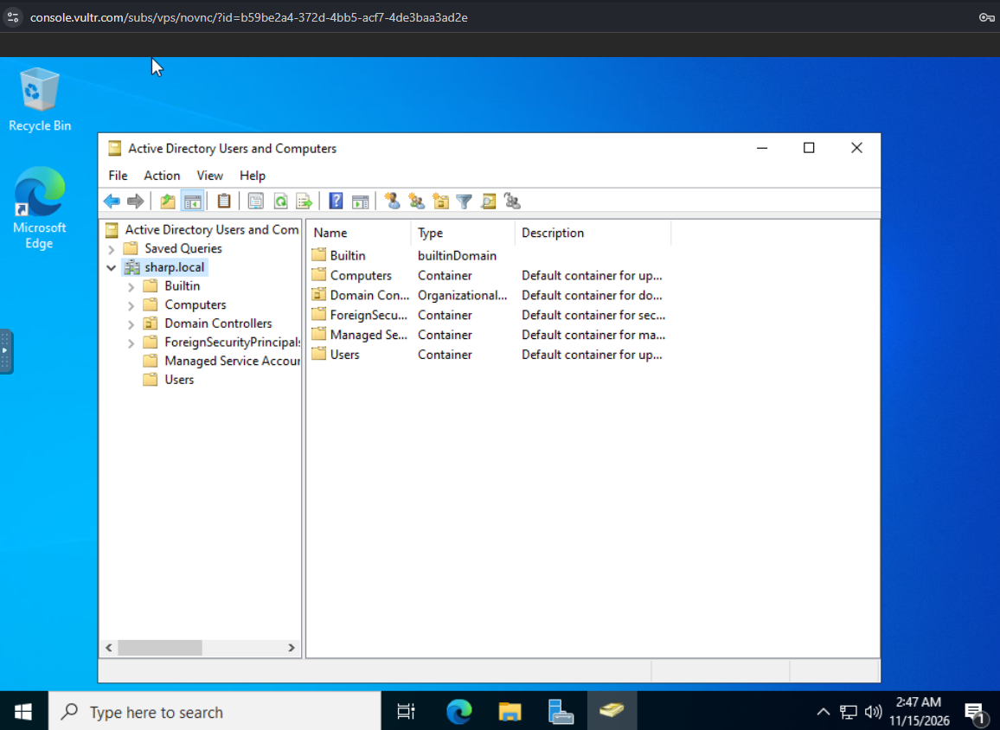

### Step 4: Preparing the Windows Test Machine

Next, I accessed the Windows test machine to prepare it for integration with the Active Directory environment.

I opened **System Properties** to review its computer name and current workgroup membership.

The screenshot captures the machine before its domain membership was verified.

For domain integration, the test machine must use DNS capable of resolving the `sharp.local` Active Directory domain, typically through the Domain Controller's DNS service.


### Step 5: Troubleshooting Remote Desktop Authentication

While attempting to connect to the Windows test machine using the domain user account `SHARP\JSmith`, I encountered the following error:

> The connection was denied because the user account is not authorized for remote login.

This indicated that the attempted account did not have the necessary Remote Desktop logon authorization on the target system.

The error was related to remote logon permissions rather than establishing that the account password was incorrect.


### Step 6: Configuring Remote Desktop User Permissions

To address the authorization issue, I opened the Windows **System Properties** Remote settings and accessed the **Remote Desktop Users** configuration.

From the domain location `sharp.local`, I selected the account **Jenny Smith (`JSmith`)** for inclusion in the permitted Remote Desktop users.

This step was intended to grant the domain account permission to establish an RDP session on the test machine.

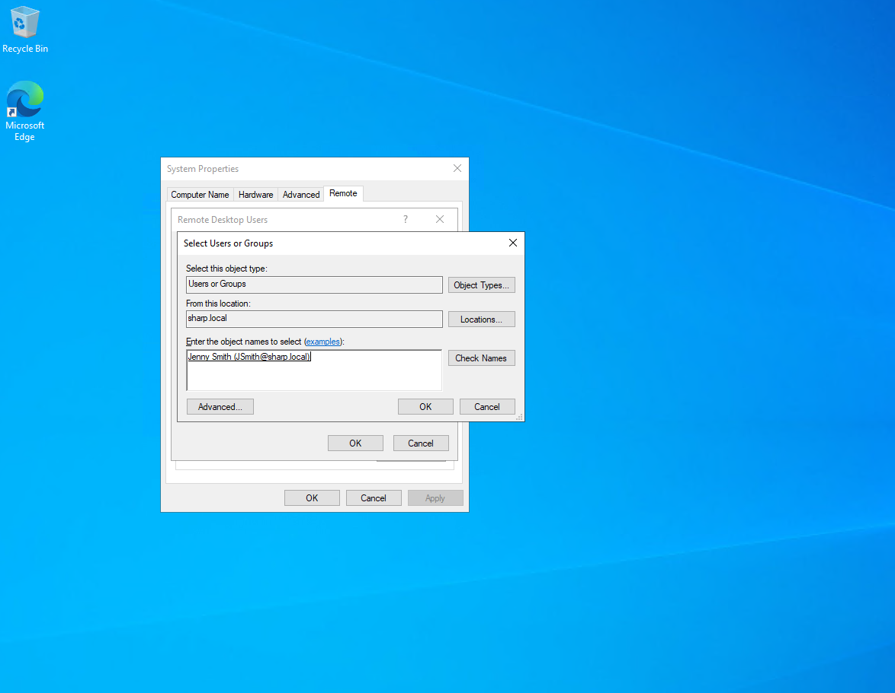

The screenshot documents the user selection process. A successful login test is still needed to confirm that the permission change took effect.

### Part 3: Results

During this phase, I:

- Selected and installed the Active Directory Domain Services role.
- Configured a new Active Directory forest named `sharp.local`.
- Verified the domain through Active Directory Users and Computers.
- Reviewed the Windows test machine's computer and domain settings.
- Investigated a domain-user Remote Desktop authorization error.
- Configured the domain user selection for Remote Desktop access.

---

## Part 4: Splunk SIEM Deployment & Windows Event Log Integration

### Overview

In this phase, I deployed Splunk Enterprise on the Ubuntu server, configured Windows Universal Forwarders, collected Windows Security event logs, and verified telemetry from both Windows systems inside Splunk.

I also encountered and resolved a forwarding configuration issue on the Domain Controller. During the Universal Forwarder setup, I mistakenly used the Domain Controller's private VPC address instead of the Splunk server's private VPC address. After identifying the issue, I corrected the forwarding destination to the Splunk server and restarted the SplunkForwarder service.

### Step 1: Preparing the Ubuntu Splunk Server

Before installing Splunk, I prepared the Ubuntu server and created a simple Bash script to update and upgrade installed packages.

```bash
#!/bin/bash

sudo apt update -y && sudo apt upgrade -y
```


### Step 2: Downloading Splunk Enterprise

I downloaded the Splunk Enterprise Debian package directly from Splunk using `wget`.

The package downloaded was Splunk Enterprise 10.6.1.1 for Linux AMD64.


After installing Splunk, the application files were available under:

```text
/opt/splunk/bin
```

This directory contains the Splunk command-line utilities used to start, stop, and manage the Splunk instance.

### Step 3: Configuring Splunk Web Access

Splunk Web uses TCP port **8000**.

I first worked on adding an inbound TCP rule for port 8000 through the Vultr firewall configuration.


I also allowed port 8000 through the Ubuntu host firewall using UFW.

```bash
ufw allow 8000
```

The screenshot below shows the Splunk installation directory and the successful addition of the UFW rule.

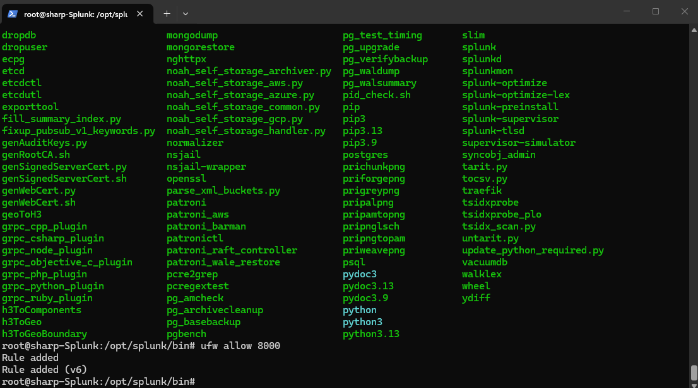

This allowed the Splunk web interface to be accessed remotely.

### Step 4: Configuring Splunk Preferences

After accessing Splunk Enterprise through the web interface, I reviewed the administrator preferences.

I configured the interface time zone to **GMT (Greenwich Mean Time)** to keep timestamps consistent during event analysis.


### Step 5: Installing the Splunk Add-on for Microsoft Windows

I installed the **Splunk Add-on for Microsoft Windows**.

This add-on provides additional support for parsing and working with Windows event data inside Splunk.


### Step 6: Enabling the Splunk Receiving Port

To receive data from the Windows Universal Forwarders, I configured the Splunk server to listen on TCP port **9997**.


I then allowed port 9997 through the Ubuntu firewall.

```bash
ufw allow 9997
```


Port 9997 is used by the Universal Forwarders to send event data to the Splunk server.

### Step 7: Installing the Splunk Universal Forwarder

I installed the **Splunk Universal Forwarder** on the Windows systems.

The Universal Forwarder collects selected Windows event logs and sends them to the Splunk server for indexing and analysis.


After installation, the local configuration files were stored under:

```text
C:\Program Files\SplunkUniversalForwarder\etc\system\local\
```


### Step 8: Configuring Windows Security Event Collection

I configured `inputs.conf` to collect events from the Windows Security log and send them into my custom Splunk index named:

```text
sharp-ad
```

The Security log input included:

```ini
[WinEventLog://Security]
index = sharp-ad
disabled = false
```


This allowed authentication and other Windows Security events to be collected by the forwarder.

### Step 9: Reviewing the SplunkForwarder Service

I reviewed the Windows **SplunkForwarder** service configuration to confirm which account was being used to run the service.

The screenshot shows the forwarder configured under:

```text
NT SERVICE\SplunkForwarder
```


### Step 10: Troubleshooting Initial Event Ingestion

After configuring the forwarder, I searched the custom Splunk index:

```spl
index=sharp-ad
```

Initially, Splunk returned **0 events**.


This indicated that the forwarding pipeline was not yet working correctly.

### Step 11: Verifying Initial Event Ingestion

After continuing the configuration and troubleshooting process, events began appearing inside the `sharp-ad` index.

The first successful search showed over **1,000 Windows Security events** being indexed.


This confirmed that the Windows Universal Forwarder was successfully communicating with the Splunk server.

### Step 12: Troubleshooting the Domain Controller Forwarder

When installing the Universal Forwarder on the Domain Controller, I ran into a configuration issue.

During setup, I mistakenly entered the Domain Controller's VPC address:

```text
10.5.96.4
```

instead of the Splunk server's VPC address:

```text
10.5.96.5
```

The screenshot below captures the Universal Forwarder configuration during this troubleshooting process.


After identifying the mistake, I corrected the forward server from the Domain Controller using PowerShell.

I removed the incorrect destination:

```powershell
& "C:\Program Files\SplunkUniversalForwarder\bin\splunk.exe" remove forward-server 10.5.96.4:9997
```

I then added the correct Splunk server destination:

```powershell
& "C:\Program Files\SplunkUniversalForwarder\bin\splunk.exe" add forward-server 10.5.96.5:9997
```

I restarted the SplunkForwarder service so the new configuration would take effect:

```powershell
Restart-Service SplunkForwarder
```

The Domain Controller's Universal Forwarder configuration directory contained the local configuration files, including `inputs.conf` and `outputs.conf`.

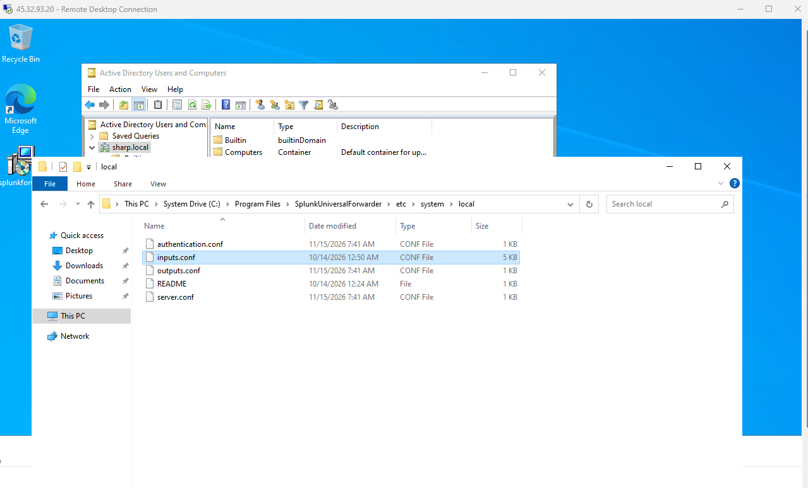

I then restarted the SplunkForwarder service.


This troubleshooting step was important because the forwarder must send events to the **Splunk server**, not to the machine generating the events.

### Step 13: Verifying Both Windows Hosts in Splunk

After correcting the Domain Controller's forwarding destination, I searched the `sharp-ad` index again.

Splunk now showed **1,208 events**.

More importantly, the `host` field contained two Windows systems:

- `vultr-guest`
- `sharp-ADDC01`


This confirmed that both the Windows test machine and Domain Controller were successfully forwarding Windows event logs into Splunk.

### Step 14: Researching Successful Windows Logons

With telemetry successfully reaching Splunk, I began researching Windows authentication events.

Windows Security Event ID **4624** represents a successful account logon.

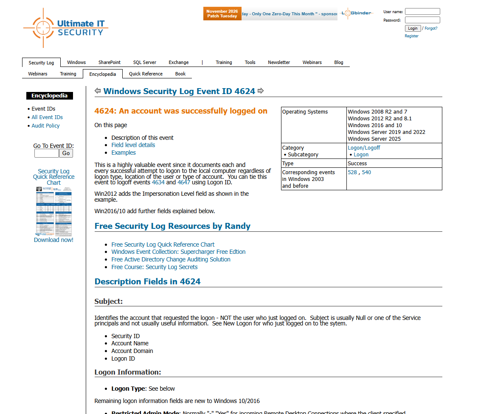

I also reviewed the different Windows logon types to understand which authentication events would be relevant to Remote Desktop activity.


Some important logon types include:

- **2 — Interactive:** Local console login
- **3 — Network:** Authentication over the network
- **7 — Unlock:** Unlocking an existing Windows session
- **10 — RemoteInteractive:** Remote Desktop or Terminal Services login

For RDP detection, **Logon Type 10** is particularly important.

### Step 15: Searching Successful Authentication Events

I first searched for successful Windows authentication events using Event ID 4624:

```spl
index=sharp-ad EventCode=4624
```

The query returned **259 successful logon events**.


### Step 16: Filtering Relevant Logon Types

I then narrowed the results to logon types **7** and **10**:

```spl
index=sharp-ad EventCode=4624 (Logon_Type=7 OR Logon_Type=10)
```

The filtered query returned **9 events**.


This reduced the number of events that needed to be reviewed and helped isolate activity related to workstation unlocks and remote interactive sessions.

### Step 17: Inspecting a Successful Logon Event

I opened one of the resulting events to review the raw Windows Security event information.

The event showed:

```text
Account Name: jsmith
Account Domain: SHARP
Logon Type: 7
```


Logon Type 7 represents a workstation unlock.

This helped confirm that not every successful Event ID 4624 result represented a new Remote Desktop connection.

For detecting RDP activity specifically, I will focus primarily on **Logon Type 10**.

### Part 4: Results

During this phase, I:

- Deployed Splunk Enterprise on the Ubuntu server.
- Configured Splunk Web access on TCP port 8000.
- Installed the Splunk Add-on for Microsoft Windows.
- Enabled Splunk receiving on TCP port 9997.
- Installed Splunk Universal Forwarders on the Windows systems.
- Configured Windows Security event collection.
- Created and used the `sharp-ad` index.
- Troubleshot an incorrect forwarding destination on the Domain Controller.
- Changed the forwarder target from `10.5.96.4:9997` to `10.5.96.5:9997`.
- Restarted the SplunkForwarder service.
- Verified event ingestion from both Windows systems.
- Investigated successful Windows Event ID 4624 activity.
- Filtered Windows logon events by Logon Types 7 and 10.
- Identified the difference between workstation unlock events and Remote Desktop logons.
---

## Part 5: Shuffle SOAR, Slack Alerting & Analyst Approval

### Overview

In this final phase, I connected the Splunk detection workflow to Shuffle SOAR and Slack so successful authentication detections could generate external notifications and request analyst review.

The completed workflow supports:

- Splunk detection alerts
- Shuffle webhook ingestion
- Slack security notifications
- Email-based analyst approval or rejection

Active Directory account disablement was **not implemented or verified** in this phase. The workflow currently stops at the analyst decision stage, with remediation left as future work.

### Step 1: Creating the Shuffle SOAR Workflow

I created a Shuffle workflow named `sharp-AD-Project-2.0` and added a webhook trigger named `Splunk-Alert`.

The webhook acts as the entry point for Splunk alert data and allows Shuffle to receive the JSON payload generated when the detection fires.

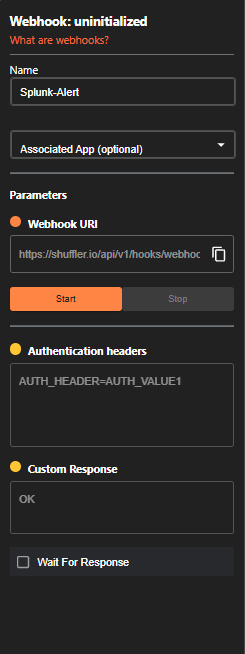

### Step 2: Connecting the Splunk Alert to Shuffle

I updated the Splunk alert named:

```text
sharp-Unauthorized-Successful-Login-RDP
```

and added a **Webhook** trigger action using the URL generated by Shuffle.

This connected the Splunk detection directly to the SOAR workflow so each triggered alert could be passed into Shuffle for additional processing.


### Step 3: Verifying Splunk Events Inside Shuffle

After starting the Shuffle webhook, I triggered the Splunk detection and verified that the workflow received the event successfully.

The execution details showed the Splunk alert metadata and result fields being passed into Shuffle, including information from the detection search.


This confirmed that the **Splunk SIEM → Shuffle SOAR** connection was working.

### Step 4: Configuring Slack Incoming Webhooks

Next, I created a custom Slack application named `sharp-soc-alerts` and enabled **Incoming Webhooks**.

The incoming webhook provides an HTTP endpoint that Shuffle can use to send security notifications into Slack.


### Step 5: Adding Slack Notification Logic to Shuffle

Inside Shuffle, I added an HTTP action after the `Splunk-Alert` webhook.

This HTTP action sends a POST request to the Slack Incoming Webhook whenever a Splunk alert enters the workflow.


I first tested the connection using a basic notification.


The Shuffle HTTP action returned an HTTP **200** response with a successful result, confirming that Slack accepted the webhook request.


### Step 6: Building a Structured SOC Alert

After confirming basic connectivity, I formatted the Slack message into a more useful SOC-style security notification.

The alert included available detection context such as:

- Source IP address
- Affected host
- Logon type
- Event count
- Detection rule name


This provided a more readable notification for an analyst reviewing the event.

### Step 7: Adding Human-in-the-Loop Analyst Approval

I then added a **User Input** action after the Slack notification.

The workflow now follows this order:

```text
Splunk Alert
    |
    v
Shuffle Webhook
    |
    v
Slack Notification
    |
    v
User Input
```

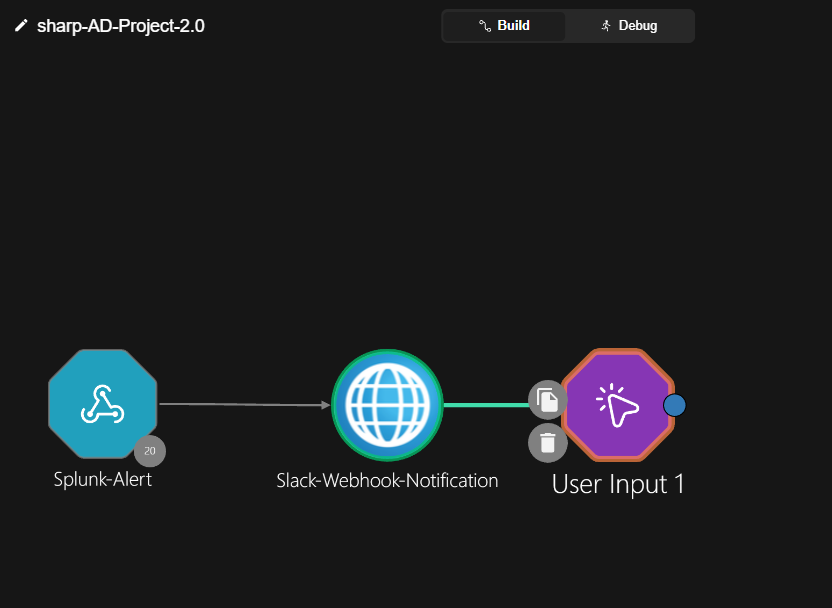

The User Input action sends an email to the analyst requesting review of the detection before any proposed remediation is performed.

### Step 8: Testing the Analyst Approval Email

I successfully received the Shuffle approval email containing the security detection information.

The email identified the detection rule and affected host and presented the event as requiring analyst review.


The analyst decision section included two options:

- **TRUE:** Approve the proposed action
- **FALSE:** Reject the proposed action

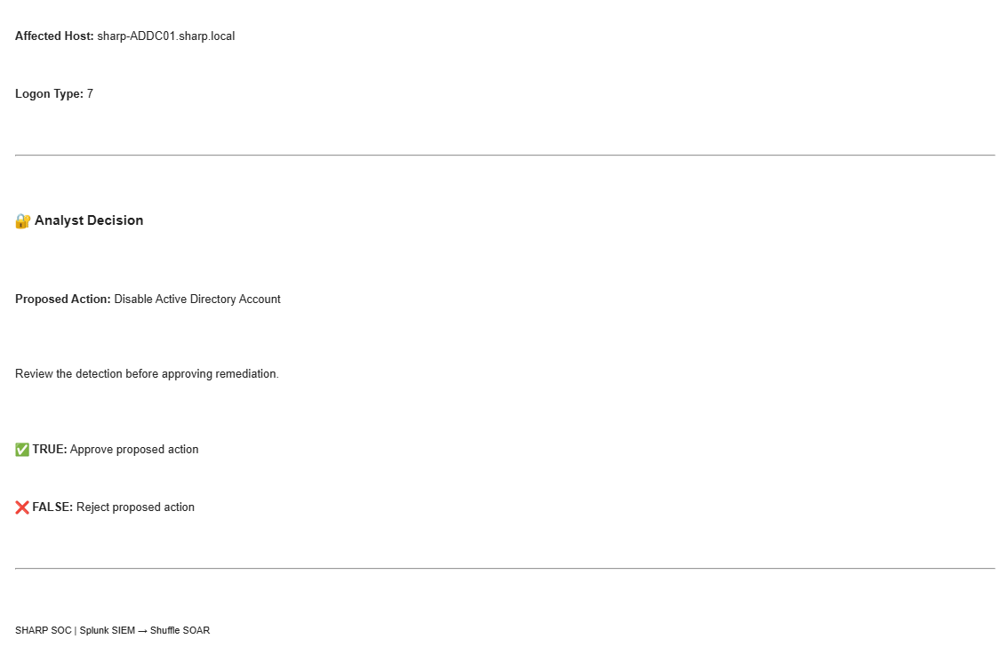

The proposed response shown in the email is to disable the Active Directory account, but that remediation action was **not connected or executed** as part of the completed project.

### Step 9: Final SOAR Workflow

The final implemented workflow contains three primary Shuffle components:

```text
Splunk-Alert
      |
      v
Slack-Webhook-Notification
      |
      v
User Input
```

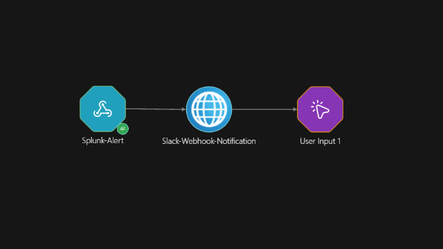

This represents the completed automation path for the project.

### Detection Configuration

The Splunk detection used for the workflow was named:

```text
sharp-Unauthorized-Successful-Login-RDP
```

The detection monitored successful Windows authentication activity using Event ID `4624` and focused on Logon Types `7` and `10` during testing.

To reduce duplicate notifications, I narrowed the search window and configured the alert to run on a shorter schedule with a single trigger per search.

The detection results were then sent to Shuffle through the configured webhook action.

### Final Workflow Architecture

```text
Windows Security Events
        |
        v
Splunk Universal Forwarder
        |
        v
Splunk Enterprise SIEM
        |
        v
Splunk Detection Alert
        |
        v
Shuffle SOAR Webhook
        |
        v
Slack Security Notification
        |
        v
Shuffle User Input
        |
        v
Analyst Approval / Rejection
        |
        v
Future: Active Directory Remediation
```

### Part 5: Results

By the end of this phase, I had:

- Created a Shuffle SOAR workflow for the project.
- Configured a webhook trigger to receive Splunk alerts.
- Connected the Splunk detection alert to Shuffle.
- Verified Splunk event data was successfully received by Shuffle.
- Created a custom Slack application with Incoming Webhooks enabled.
- Added a Slack HTTP notification action to the Shuffle workflow.
- Successfully tested Slack delivery from Shuffle.
- Built a structured SOC security alert in Slack.
- Added a User Input action for human-in-the-loop response.
- Successfully received analyst approval emails.
- Implemented TRUE and FALSE analyst decision options.
- Completed the automated workflow through the analyst approval stage.

### Project Status

The completed project successfully demonstrates an end-to-end security monitoring and human-in-the-loop response pipeline using:

**Windows → Splunk SIEM → Shuffle SOAR → Slack → Analyst Approval**

The project does **not** automatically disable Active Directory accounts. Active Directory remediation remains a future extension that could be added after analyst approval.

---

## Final Project Outcome

This project provided hands-on experience building a small SOC automation environment from the ground up.

The completed environment includes:

- Active Directory infrastructure
- Windows endpoint telemetry
- Splunk SIEM log ingestion
- Authentication detection logic
- Shuffle SOAR automation
- Slack security notifications
- Analyst approval and rejection workflows

The result is a functional detection and response pipeline that collects Windows security events, identifies targeted authentication activity, sends alerts to external systems, and introduces analyst decision-making before remediation.