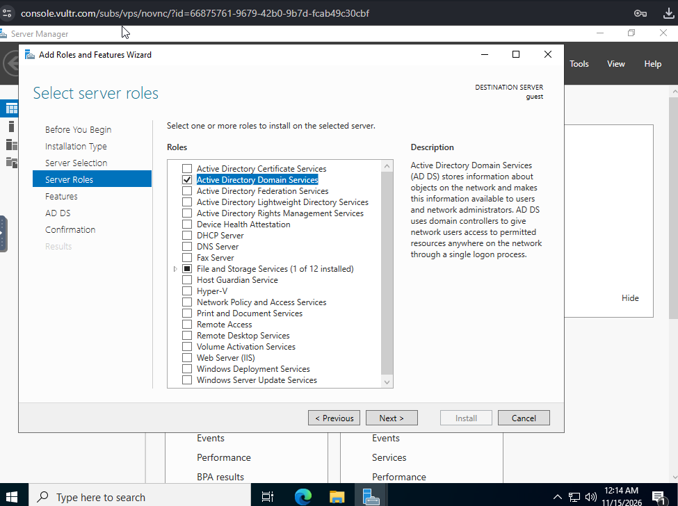

# Active Directory 2.0 — SOC Automation & Incident Response

A hands-on cybersecurity project focused on building a simulated enterprise SOC environment using Active Directory, Splunk SIEM, Shuffle SOAR, and Slack for threat detection and automated incident response.

---

## Part 1: Project Overview & Architecture

### Project Overview

In this project, I'm building an Active Directory environment to simulate real-world cyberattacks, monitor suspicious authentication activity, and automate security responses.

The goal is to understand how different security technologies work together in a SOC environment, from collecting security logs to detecting threats and responding to potential account compromises.

### 🖥️ Lab Architecture

The environment consists of three virtual machines hosted on Vultr:

| Virtual Machine | Operating System | Purpose |
|---|---|---|
| Domain Controller (`sharp-ADDC01`) | Windows Server 2025 Standard | Planned Active Directory users, accounts, and authentication management |
| Splunk Server (`sharp-Splunk`) | Ubuntu Server 22.04 | Planned security log collection and analysis |
| Test Machine | Windows Server 2022 Core | Simulated endpoint for testing |

### 🔄 Planned Security Workflow

The project is designed to follow this incident response process:

1. **Attack Simulation:** An attacker attempts to authenticate to the Windows test machine.
2. **Log Collection:** Authentication activity is forwarded to Splunk for monitoring.
3. **Threat Detection:** Splunk identifies suspicious activity and generates a security alert.
4. **SOAR Automation:** The alert triggers a Shuffle SOAR playbook and sends a notification to Slack.
5. **Analyst Review:** Shuffle notifies a SOC analyst, who determines whether the affected account should be disabled.
6. **Incident Response:** If approved, the domain account is disabled and a confirmation is sent to Slack. Otherwise, no automated remediation occurs.

### 🎯 Project Objectives

Through this project, I aim to develop hands-on experience with:

- **Active Directory:** Identity and access management
- **Splunk SIEM:** Security monitoring and threat detection
- **Shuffle SOAR:** Security orchestration and automated incident response
- **Slack:** Security alert notifications
- **Windows Security Logs:** Authentication monitoring and investigation
- **Cloud Networking:** Virtual machine deployment, firewall configuration, and private networking

### Part 1 Summary

This phase focused on understanding the overall architecture, identifying the required technologies, and planning how the different systems will communicate.

The next phase involves deploying and configuring the infrastructure needed to support the environment.

---

## Part 2: Cloud Infrastructure & Network Configuration

### Overview

In this phase, I deployed virtual machines on Vultr, configured firewall rules for remote access, established private networking, and troubleshot connectivity issues between the servers.

The objective was to prepare a functioning cloud environment before configuring Active Directory and integrating the security monitoring tools.

### Step 1: Deploying the Virtual Machines

I deployed three virtual machines in Vultr's **Los Angeles region**:

- **Windows Server 2025 Standard:** Future Active Directory Domain Controller (`sharp-ADDC01`)
- **Windows Server 2022 Core:** Windows Test Machine
- **Ubuntu Server 22.04:** Future Splunk SIEM Server (`sharp-Splunk`)

The instance dashboard shows all three machines and their operating systems. It also captures their running or stopped status at that point in the deployment.

### Step 2: Configuring Firewall Security

I created a Vultr firewall group named `sharp-AD-Project-2.0` to restrict administrative access. The configured inbound rules shown in the screenshot allow SSH (port 22) and RDP (port 3389) from a specified `/32` public IP, with a default deny rule for other inbound traffic.

I then checked the firewall group selection on the intended Domain Controller instance.

I also reviewed the firewall group selection on the Windows test machine.

**Note:** The firewall rule screenshot shows **zero attached instances** at that moment, while the instance settings screenshots show firewall groups selected. These screenshots document configuration steps at different times; they do not, by themselves, prove the rules were active on both machines simultaneously.

### Step 3: Establishing Remote Access

I accessed the Windows server through Remote Desktop Protocol (RDP) to perform configuration directly inside the operating system.

The following screenshot shows the established Windows desktop session.

### Step 4: Configuring Private VPC Networking

I configured a Vultr VPC connection for internal communication between the servers, reducing the need to use public IP addresses for server-to-server traffic.

The Windows instance's VPC settings show its assigned private address and network details.

I also checked the Ubuntu server's public IPv4 configuration while reviewing its network connectivity. **This screenshot shows its public network settings, not its VPC address.**

On the Windows test machine, I opened the secondary adapter's IPv4 properties and manually entered a private address and subnet mask for the VPC network.

### Step 5: Troubleshooting Network Connectivity

I tested connectivity from the Ubuntu server using `ping`. The initial attempts to reach the Windows test machine's private address returned **Destination Host Unreachable** messages. A separate public-address test also showed packet loss.

After adjusting the network configuration, the same terminal session showed successful ICMP replies from the previously unreachable private address.

I then ran another ping test to the other Windows server's private address and received successful ICMP replies.

These tests confirmed basic ICMP reachability to the two private targets shown. Additional service-level checks will be needed when Active Directory and Splunk are configured.

### ✅ Part 2: Results

By the end of this phase, I had:

- Deployed three Vultr instances in the Los Angeles region.
- Created firewall rules limiting SSH and RDP access to a specified source IP.
- Accessed a Windows server through RDP.
- Attached and configured private VPC networking on the Windows environment.
- Configured a static private IPv4 address on a Windows network adapter.
- Troubleshot failed ICMP connectivity tests.
- Verified successful ICMP replies to two Windows private IP addresses from Ubuntu.

### Next Steps

1. Install and configure Active Directory Domain Services.
2. Promote the Windows Server to a Domain Controller.
3. Configure the domain and DNS.
4. Join the Windows test machine to the domain.
5. Prepare Windows security event collection for Splunk.

---

## Part 3: Active Directory Deployment & Remote Access Configuration

### Overview

In this phase, I configured Active Directory Domain Services (AD DS), established a new Active Directory forest, and began integrating the Windows test machine into the domain environment.

I also investigated a Remote Desktop authentication issue involving a domain user account and configured the appropriate remote access permissions.

### Step 1: Installing Active Directory Domain Services

I accessed the Windows Server through the Vultr console and opened Server Manager.

Using the **Add Roles and Features Wizard**, I selected the **Active Directory Domain Services (AD DS)** server role.

AD DS provides centralized identity management, authentication, and access control for Windows domain environments.

### Step 2: Promoting the Server to a Domain Controller

After installing the AD DS role, I launched the Active Directory Domain Services Configuration Wizard.

Because this was a new environment, I selected **Add a new forest** and configured the following root domain:

- **Root domain:** `sharp.local`
- **Deployment type:** New Active Directory forest
- **Server role:** Domain Controller

This establishes the foundation for centralized authentication and domain management.

### Step 3: Verifying the Active Directory Domain

After the domain configuration, I opened **Active Directory Users and Computers (ADUC)** to verify that the new domain was available.

The console displayed `sharp.local` and its default Active Directory containers, including:

- Builtin
- Computers
- Domain Controllers
- ForeignSecurityPrincipals
- Managed Service Accounts
- Users

This confirmed that the Active Directory domain was accessible through the management console.

### Step 4: Preparing the Windows Test Machine

Next, I accessed the Windows test machine to prepare it for integration with the Active Directory environment.

I opened **System Properties** to review its computer name and current workgroup membership.

The screenshot captures the machine before its domain membership was verified.

For domain integration, the test machine must use DNS capable of resolving the `sharp.local` Active Directory domain, typically through the Domain Controller's DNS service.

### Step 5: Troubleshooting Remote Desktop Authentication

While attempting to connect to the Windows test machine using the domain user account `SHARP\JSmith`, I encountered the following error:

> The connection was denied because the user account is not authorized for remote login.

This indicated that the attempted account did not have the necessary Remote Desktop logon authorization on the target system.

The error was related to remote logon permissions rather than establishing that the account password was incorrect.

### Step 6: Configuring Remote Desktop User Permissions

To address the authorization issue, I opened the Windows **System Properties** Remote settings and accessed the **Remote Desktop Users** configuration.

From the domain location `sharp.local`, I selected the account **Jenny Smith (`JSmith`)** for inclusion in the permitted Remote Desktop users.

This step was intended to grant the domain account permission to establish an RDP session on the test machine.

The screenshot documents the user selection process. A successful login test is still needed to confirm that the permission change took effect.

### Part 3: Results

During this phase, I:

- Selected and installed the Active Directory Domain Services role.
- Configured a new Active Directory forest named `sharp.local`.
- Verified the domain through Active Directory Users and Computers.
- Reviewed the Windows test machine's computer and domain settings.
- Investigated a domain-user Remote Desktop authorization error.
- Configured the domain user selection for Remote Desktop access.

### Next Steps

1. Verify the Windows test machine is successfully joined to `sharp.local`.
2. Confirm that the `JSmith` account can authenticate through Remote Desktop.
3. Verify DNS resolution and domain connectivity.
4. Configure Windows security event logging.
5. Begin preparing the Splunk SIEM integration.
