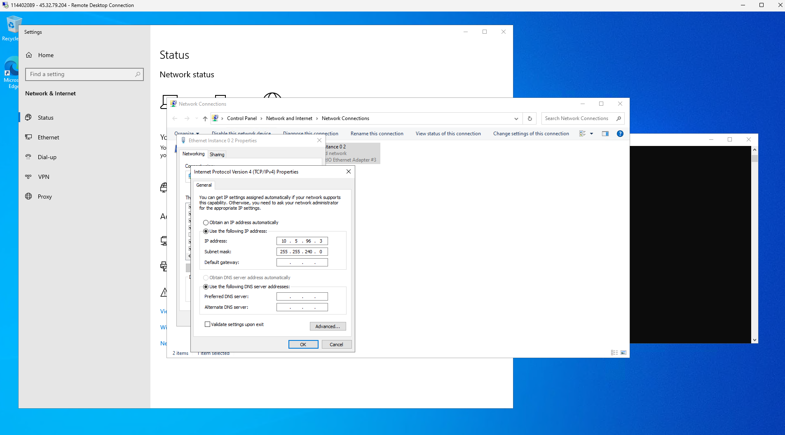

# Active Directory 2.0 — SOC Automation & Incident Response

A hands-on cybersecurity project focused on building a simulated enterprise Security Operations Center (SOC) environment using Active Directory, Splunk SIEM, Shuffle SOAR, and Slack for threat detection and automated incident response.

---

## Part 1: Project Overview & Architecture

### Project Overview

In this project, I'm building an Active Directory environment to simulate real-world cyberattacks, monitor suspicious authentication activity, and automate security responses.

The goal is to understand how different security technologies work together in a SOC environment, from collecting security logs to detecting threats and responding to potential account compromises.

### 🖥️ Lab Architecture

The environment consists of three virtual machines hosted on Vultr:

| Virtual Machine | Operating System | Purpose |
|---|---|---|
| Domain Controller (`sharp-ADDC01`) | Windows Server 2025 Standard | Active Directory and authentication management |
| Splunk Server (`sharp-Splunk`) | Ubuntu Server 22.04 | Security log collection and analysis |
| Test Machine | Windows Server 2022 Core | Simulated endpoint for attack testing |

### 🔄 Planned Security Workflow

The project is designed to follow this incident response process:

1. **Attack Simulation:** An attacker attempts to authenticate to the Windows test machine.
2. **Log Collection:** Authentication activity is forwarded to Splunk for monitoring.
3. **Threat Detection:** Splunk identifies suspicious activity and generates a security alert.
4. **SOAR Automation:** The alert triggers a Shuffle SOAR playbook and sends a notification to Slack.
5. **Analyst Review:** Shuffle notifies a SOC analyst, who determines whether the affected account should be disabled.
6. **Incident Response:** If approved, the domain account is disabled and a confirmation is sent to Slack. Otherwise, no automated remediation occurs.

### 🎯 Project Objectives

Through this project, I aim to develop hands-on experience with:

- **Active Directory:** Identity and access management
- **Splunk SIEM:** Security monitoring and threat detection
- **Shuffle SOAR:** Security orchestration and automated incident response
- **Slack:** Security alert notifications
- **Windows Security Logs:** Authentication monitoring and investigation
- **Cloud Networking:** Virtual machine deployment, firewall configuration, and private networking

### Part 1 Summary

This phase focused on understanding the overall architecture, identifying the required technologies, and planning how the different systems will communicate.

The next phase involves deploying and configuring the infrastructure needed to support the environment.

---

## Part 2: Cloud Infrastructure & Network Configuration

### Overview

In this phase, I deployed virtual machines on Vultr, configured firewall rules to restrict remote access, established private networking, and troubleshot connectivity issues between the servers.

The objective was to prepare a functioning cloud environment before configuring Active Directory and integrating the security monitoring tools.

### Step 1: Deploying the Virtual Machines

I started by deploying three virtual machines in Vultr's **Los Angeles region**.

Each server was assigned a specific role within the environment:

- **Windows Server 2025 Standard (`sharp-ADDC01`):** Future Active Directory Domain Controller
- **Windows Server 2022 Core:** Windows Test Machine
- **Ubuntu Server 22.04 (`sharp-Splunk`):** Future Splunk SIEM Server

Deploying the servers in the same region allowed me to configure private network communication between them.

The Vultr instance dashboard shows the three deployed servers, their operating systems, and their instance statuses at the time of the screenshot.

### Step 2: Configuring Firewall Security

After deploying the servers, I created a Vultr firewall group named `sharp-AD-Project-2.0` to restrict inbound network traffic.

I configured the following rules:

- **SSH (Port 22):** Allowed administrative access from my designated public IP address.
- **RDP (Port 3389):** Allowed Remote Desktop connections from my designated public IP address.
- **Default Deny:** Blocked other inbound traffic not explicitly permitted.

Restricting administrative access to a specific source IP helped reduce unnecessary exposure to external connections.

The firewall configuration screenshot shows the inbound rules and their permitted source addresses.

#### Applying the Firewall to the Domain Controller

I assigned the firewall group to the Windows Server instance intended to serve as the Active Directory Domain Controller.

#### Reviewing the Test Machine Firewall Configuration

I also reviewed the firewall configuration for the Windows test machine to ensure remote administration would be restricted appropriately.

### Step 3: Establishing Remote Access

After configuring the firewall rules, I connected to the Windows servers using **Remote Desktop Protocol (RDP)**.

Remote access allowed me to manage the Windows environments, inspect their network adapters, and configure networking without relying exclusively on the Vultr web console.

The screenshot below documents an established Windows Remote Desktop session.

### Step 4: Configuring Private VPC Networking

Next, I configured Vultr's **Virtual Private Cloud (VPC)** networking to allow the virtual machines to communicate through private IP addresses rather than relying on their public interfaces.

The objective was to establish an internal network for future Active Directory communication, Windows event collection, and Splunk monitoring.

#### Verifying the VPC Assignment

I reviewed the VPC configuration on the Windows server and confirmed that the instance had a private network interface assigned.

#### Reviewing the Splunk Server Network Configuration

I also reviewed the Ubuntu server's network settings to verify its configuration before testing communication with the Windows servers.

#### Configuring Static IPv4 Addresses

On the Windows servers, I configured static IPv4 addresses on the secondary network adapters associated with the private network.

This was intended to provide predictable addressing for communication between the Domain Controller, test machine, and Splunk server.

The screenshot below shows the Windows IPv4 properties used during configuration.

### Step 5: Troubleshooting Network Connectivity

After configuring private networking, I tested connectivity between the Ubuntu server and the Windows servers using the `ping` command.

#### Initial Connectivity Issues

During testing, some connection attempts failed with **Destination Host Unreachable** messages and packet loss.

This indicated that the targeted systems were not consistently reachable through the network configuration being tested.

The screenshot below documents the unsuccessful attempts alongside subsequent troubleshooting tests.

#### Verifying Successful Connectivity

After reviewing and adjusting the network configuration, I repeated the connectivity tests.

The Ubuntu server successfully received ICMP replies from the Windows servers using their private IP addresses.

The successful test shown below demonstrates that the target responded to ICMP traffic over the configured private network.

These results confirmed basic network reachability, providing a foundation for future Active Directory and security monitoring integrations.

### ✅ Part 2: Results

By the end of this phase, I had:

- Deployed three virtual machines in Vultr's Los Angeles region.
- Created firewall rules to restrict administrative access.
- Established remote access to the Windows environment.
- Configured private VPC networking.
- Assigned static private IP addresses to Windows network interfaces.
- Investigated and corrected network connectivity issues.
- Verified successful ICMP communication between the Ubuntu server and Windows systems.

### Next Steps

With the initial cloud infrastructure and networking configured, the next phase will focus on establishing Active Directory services and preparing the environment for security event collection.

Planned tasks include:

1. Installing and configuring Active Directory Domain Services.
2. Promoting the Windows Server to a Domain Controller.
3. Configuring the Active Directory domain and DNS.
4. Joining the Windows test machine to the domain.
5. Preparing Windows security event collection for Splunk.

---

**Project:** Active Directory 2.0 — SOC Automation & Incident Response  
**GitHub:** [sharpleynate/Active-Directory-2.0](https://github.com/sharpleynate/Active-Directory-2.0)
