# Active Directory 2.0 | SOC Automation & Incident Response

Enterprise style SOC lab using Active Directory, Splunk SIEM, Shuffle SOAR, and Slack for threat detection, alerting, and analyst review.


---

## Part 1: Project Overview & Architecture

### Project Overview

In this project, I built an Active Directory and SOC lab to simulate Windows authentication activity, collect security telemetry, detect suspicious logon events, and route alerts to an analyst for review.

The goal was to understand how identity, endpoint logging, SIEM detection, SOAR automation, and analyst decision-making work together in a practical SOC workflow.

### 🖥️ Lab Architecture

The environment consists of three virtual machines hosted on Vultr:

| Virtual Machine | Operating System | Purpose |
|---|---|---|
| Domain Controller (`sharp-ADDC01`) | Windows Server 2025 Standard | Hosts Active Directory Domain Services and manages domain authentication |
| Splunk Server (`sharp-Splunk`) | Ubuntu Server 22.04 | Runs Splunk Enterprise for log ingestion, searching, and alerting |
| Test Machine | Windows Core 2022 Standard | Domain-joined endpoint used to generate and monitor authentication activity |

### 🔄 Security Workflow

The completed workflow follows this path:

1. **Authentication Activity:** Windows systems generate Security event logs related to user authentication.
2. **Log Collection:** Splunk Universal Forwarders send Windows Security logs to Splunk Enterprise.
3. **Threat Detection:** Splunk monitors Event ID `4624` and filters relevant Windows logon types.
4. **Security Alerting:** A Splunk detection alert sends event data to a Shuffle webhook.
5. **SOAR Processing:** Shuffle receives the alert and passes it through the configured workflow.
6. **Slack Notification:** Shuffle sends a structured security notification to Slack.
7. **Analyst Review:** Shuffle sends an email requesting analyst approval or rejection.
8. **Analyst Decision:** The analyst responds through the email workflow.

### 🎯 Project Objectives

Through this project, I developed hands-on experience with:

- **Active Directory:** Domain services, authentication, users, and domain-joined systems
- **Splunk SIEM:** Windows event ingestion, searching, filtering, and alerting
- **Splunk Universal Forwarder:** Sending Windows Security logs to a centralized SIEM
- **Shuffle SOAR:** Webhook-based orchestration and workflow automation
- **Slack:** Structured SOC alert notifications
- **Windows Security Logs:** Authentication monitoring using Event ID `4624` and Windows logon types
- **Cloud Networking:** Vultr deployment, firewall configuration, private VPC networking, and connectivity troubleshooting
- **SOC Investigation:** Reviewing authentication telemetry and routing detections through an analyst approval workflow

### Part 1 Summary

This phase established the architecture and workflow for the lab. The completed environment connects Active Directory, Windows endpoints, Splunk Enterprise, Shuffle SOAR, and Slack into a working monitoring and analyst review pipeline.

---

## Part 2: Cloud Infrastructure & Network Configuration

### Overview

In this phase, I deployed the lab infrastructure on Vultr, restricted remote access with firewall rules, configured private networking, and verified communication between the servers.

### Step 1: Deploying the Virtual Machines

I deployed three virtual machines in Vultr's **Los Angeles region**:

- **Windows Server 2025 Standard:** Active Directory Domain Controller (`sharp-ADDC01`)
- **Windows Core 2022 Standard:** Windows Test Machine
- **Ubuntu Server 22.04:** Splunk Server (`sharp-Splunk`)

Keeping the systems in the same region made it straightforward to build a private network between them.


### Step 2: Configuring Firewall Security

I created a Vultr firewall group named `sharp-AD-Project-2.0` and restricted administrative access to my public IP.

The inbound rules allowed:

- **SSH (22):** Remote administration of the Ubuntu server
- **RDP (3389):** Remote administration of the Windows servers
- **Default Deny:** Other inbound traffic remained blocked unless explicitly allowed


I then reviewed the firewall group selection on the Domain Controller and Windows test machine.

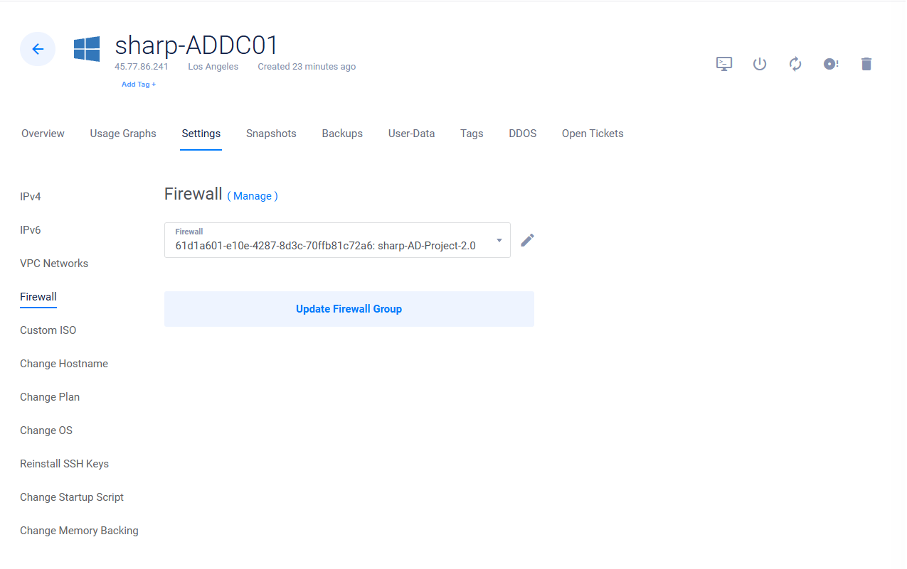

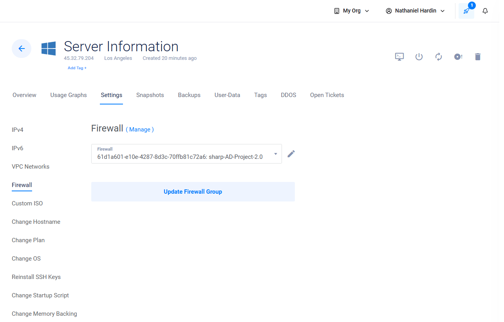

> **Note:** These screenshots were captured at different points during setup, so attachment counts and configuration states may differ between views.

### Step 3: Establishing Remote Access

With the firewall rules in place, I connected to the Windows environment through Remote Desktop Protocol (RDP) to continue configuration directly inside the operating system.


### Step 4: Configuring Private VPC Networking

I configured Vultr VPC networking so the servers could communicate over private addresses instead of relying on their public interfaces for internal traffic.

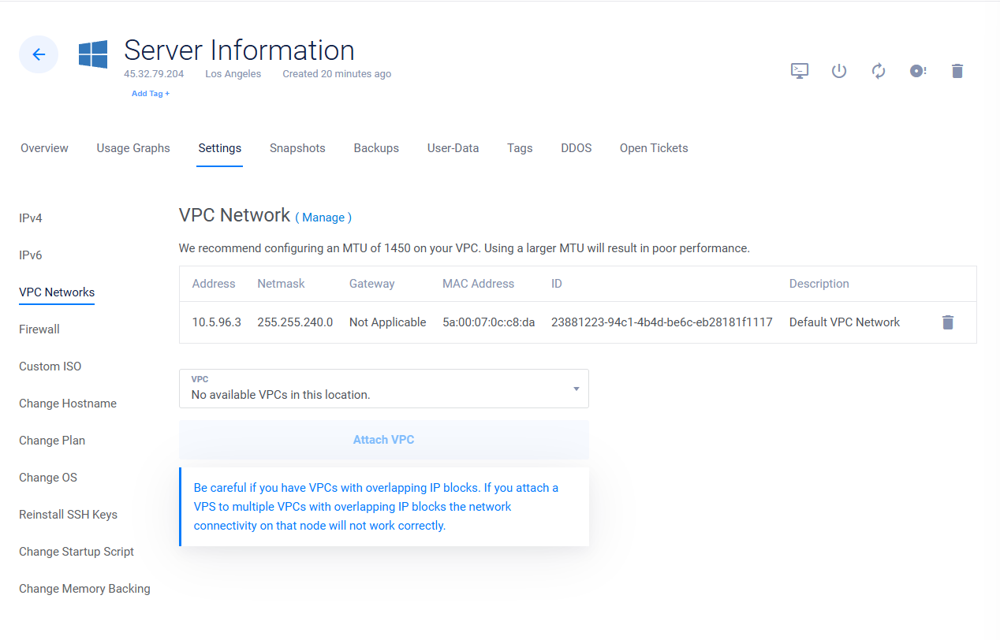

I also reviewed the Ubuntu Splunk server's network configuration while validating connectivity.

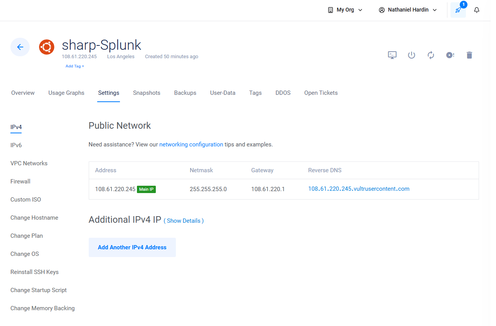

On the Windows test machine, I manually configured the secondary network adapter with a private IPv4 address and subnet mask for the VPC.


### Step 5: Troubleshooting Network Connectivity

I tested connectivity from the Ubuntu server with `ping`. The first attempts returned **Destination Host Unreachable**, confirming that the private network configuration still needed adjustment.

After correcting the network settings, the same test began receiving successful ICMP replies.


I then verified connectivity to the other Windows server over its private address.

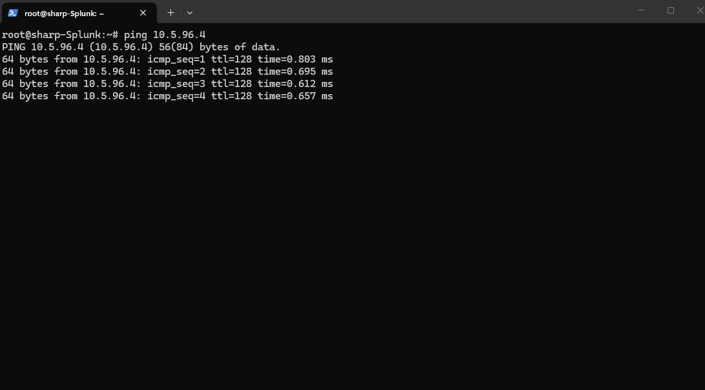

### ✅ Part 2: Results

By the end of this phase, I had:

- Deployed three Vultr virtual machines in the Los Angeles region
- Restricted SSH and RDP access with firewall rules
- Established remote access to the Windows environment
- Configured private VPC networking
- Assigned static private IPv4 settings to the Windows network interface
- Troubleshot failed connectivity
- Verified ICMP communication between the Ubuntu server and both Windows systems

---

## Part 3: Active Directory Deployment & Remote Access Configuration

### Overview

In this phase, I installed Active Directory Domain Services, created the `sharp.local` forest, prepared the Windows test machine for domain use, and worked through a Remote Desktop authorization issue for a domain user.

### Step 1: Installing Active Directory Domain Services

Using Server Manager, I opened the **Add Roles and Features Wizard** and selected **Active Directory Domain Services (AD DS)**.


### Step 2: Promoting the Server to a Domain Controller

After installing AD DS, I launched the Active Directory Domain Services Configuration Wizard and created a new forest.

- **Root domain:** `sharp.local`
- **Deployment type:** New Active Directory forest
- **Server role:** Domain Controller

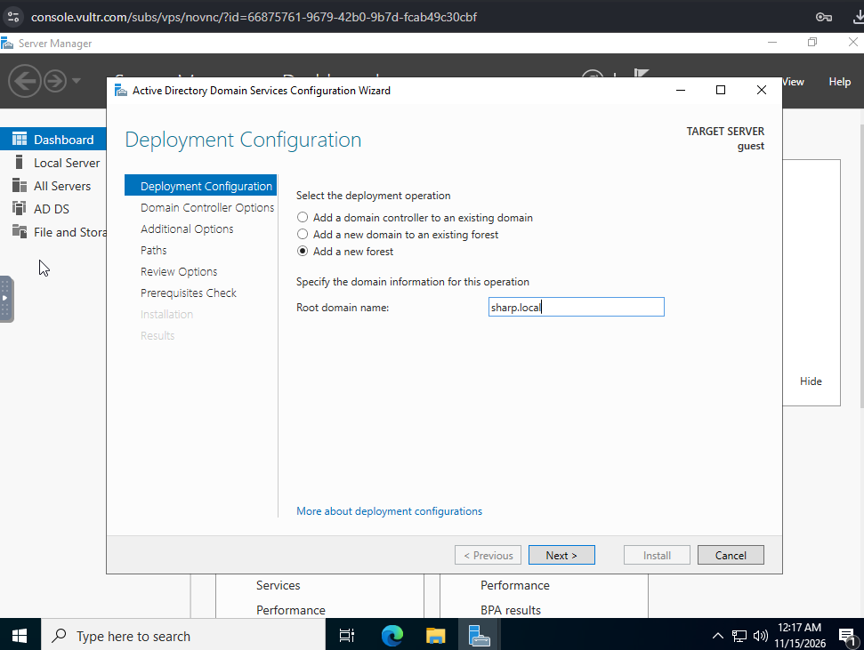

### Step 3: Verifying the Active Directory Domain

I opened **Active Directory Users and Computers (ADUC)** and confirmed that `sharp.local` was available with the expected default containers.


### Step 4: Preparing the Windows Test Machine

On the Windows test machine, I reviewed the computer name and workgroup settings before domain integration.

The screenshot below captures the machine in its pre-domain state before I completed the network and domain configuration needed for `sharp.local`.

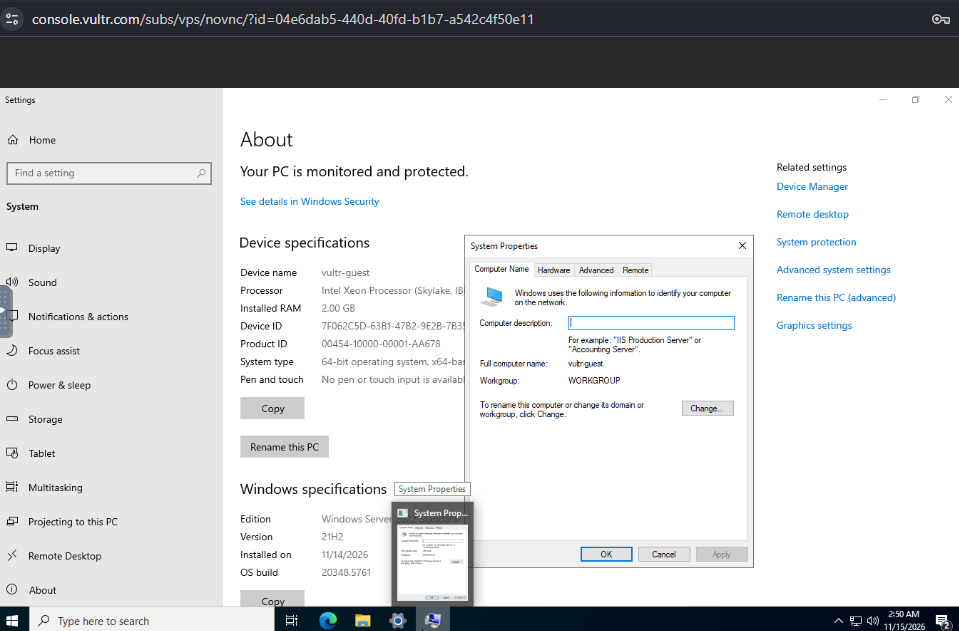

### Step 5: Troubleshooting Remote Desktop Authentication

When I attempted to connect using the domain account `SHARP\JSmith`, RDP returned an authorization error:

> The connection was denied because the user account is not authorized for remote login.

This pointed to a permissions issue rather than a network connectivity problem.

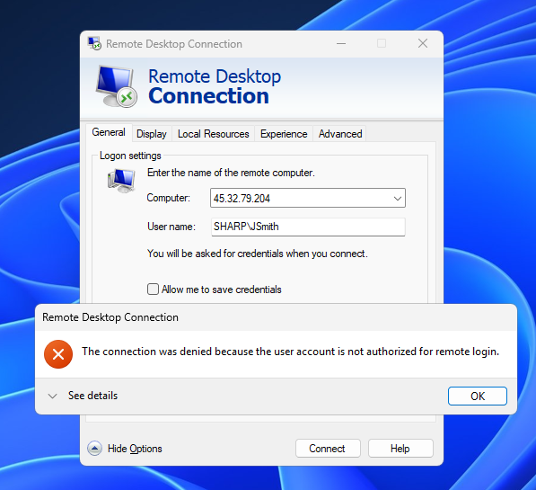

### Step 6: Configuring Remote Desktop User Permissions

To resolve the authorization issue, I opened **Remote Desktop Users** and selected **Jenny Smith (`JSmith`)** from the `sharp.local` domain.


### Part 3: Results

During this phase, I:

- Installed Active Directory Domain Services
- Created the `sharp.local` Active Directory forest
- Verified the domain through Active Directory Users and Computers
- Prepared the Windows test machine for domain integration
- Investigated a domain user RDP authorization issue
- Configured the domain user for Remote Desktop access

---

## Part 4: Splunk SIEM Deployment & Windows Event Log Integration

### Overview

In this phase, I deployed Splunk Enterprise on Ubuntu, configured Windows Universal Forwarders, collected Windows Security logs, and verified telemetry from both Windows systems.

I also worked through a forwarding issue on the Domain Controller after initially pointing the Universal Forwarder to the wrong private IP.

### Step 1: Preparing the Ubuntu Splunk Server

Before installing Splunk, I created a simple Bash script to update and upgrade the Ubuntu server.

```bash
#!/bin/bash

sudo apt update -y && sudo apt upgrade -y
```

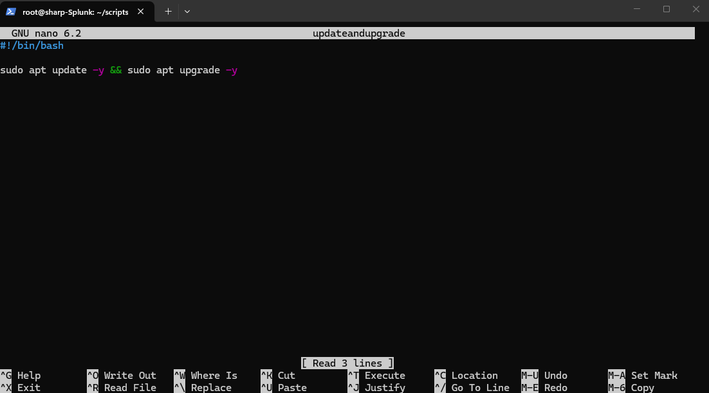

### Step 2: Downloading Splunk Enterprise

I downloaded the Splunk Enterprise Debian package using `wget`.

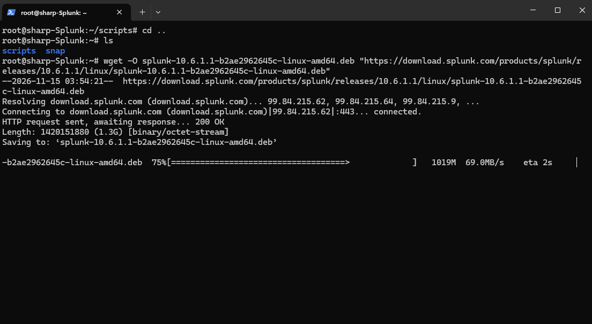

After installation, the Splunk command-line tools were available under:

```text
/opt/splunk/bin
```

### Step 3: Configuring Splunk Web Access

Splunk Web uses TCP port **8000**. I added an inbound rule in the Vultr firewall and allowed the same port through Ubuntu's local firewall.

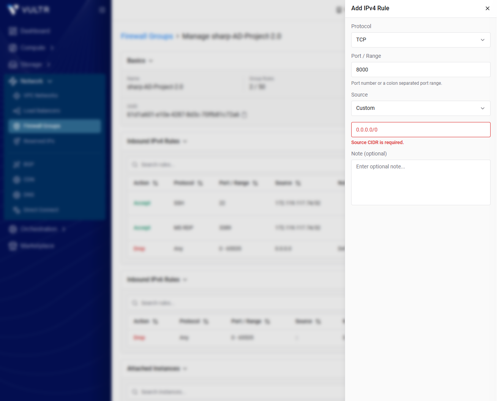

```bash
ufw allow 8000
```


### Step 4: Configuring Splunk Preferences

After accessing Splunk Web, I set the administrator time zone to **GMT (Greenwich Mean Time)** so event timestamps would remain consistent during analysis.


### Step 5: Installing the Splunk Add-on for Microsoft Windows

I installed the **Splunk Add-on for Microsoft Windows** to support Windows event data inside Splunk.


### Step 6: Enabling the Splunk Receiving Port

I configured Splunk to listen on TCP port **9997** for incoming Universal Forwarder data.

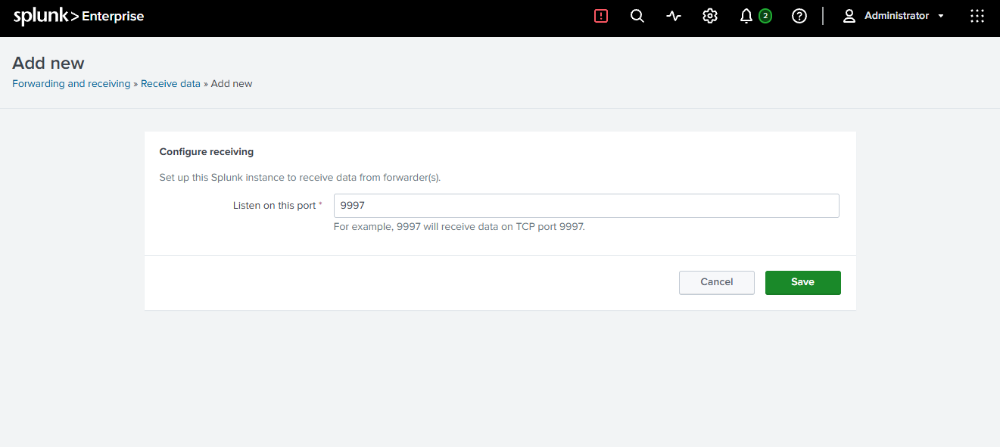

I also allowed port 9997 through UFW.

```bash
ufw allow 9997
```

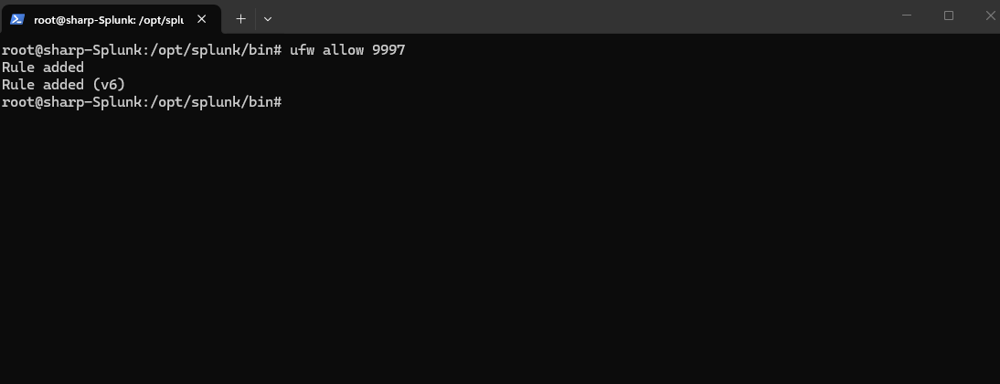

### Step 7: Installing the Splunk Universal Forwarder

I installed the **Splunk Universal Forwarder** on the Windows systems so they could send selected event logs to the Splunk server.


The local forwarder configuration files were stored under:

```text
C:\Program Files\SplunkUniversalForwarder\etc\system\local\
```

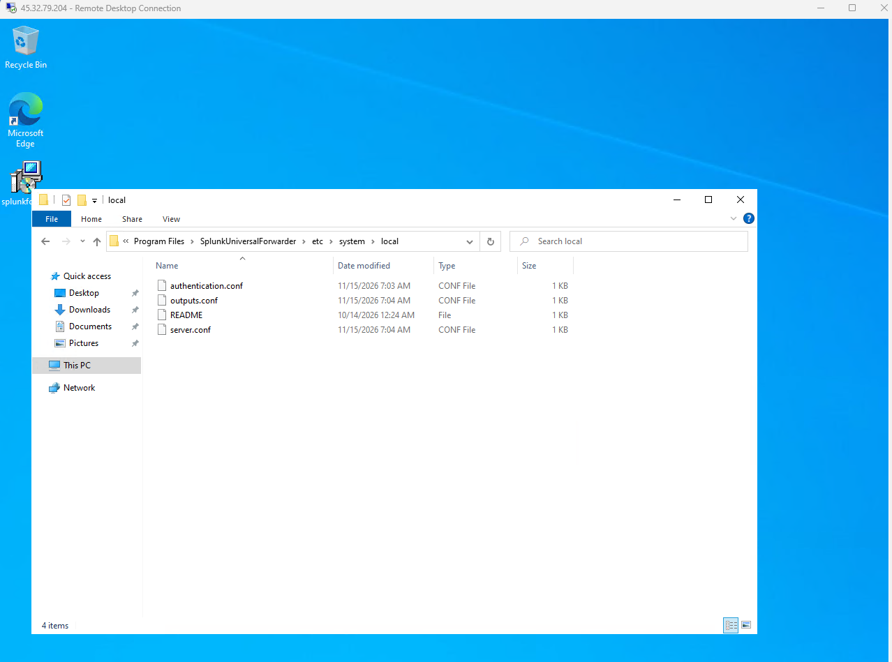

### Step 8: Configuring Windows Security Event Collection

I configured `inputs.conf` to collect Windows Security events and send them to the custom `sharp-ad` index.

```ini
[WinEventLog://Security]
index = sharp-ad
disabled = false
```


### Step 9: Reviewing the SplunkForwarder Service

I reviewed the **SplunkForwarder** Windows service and confirmed the account being used to run it.

```text
NT SERVICE\SplunkForwarder
```

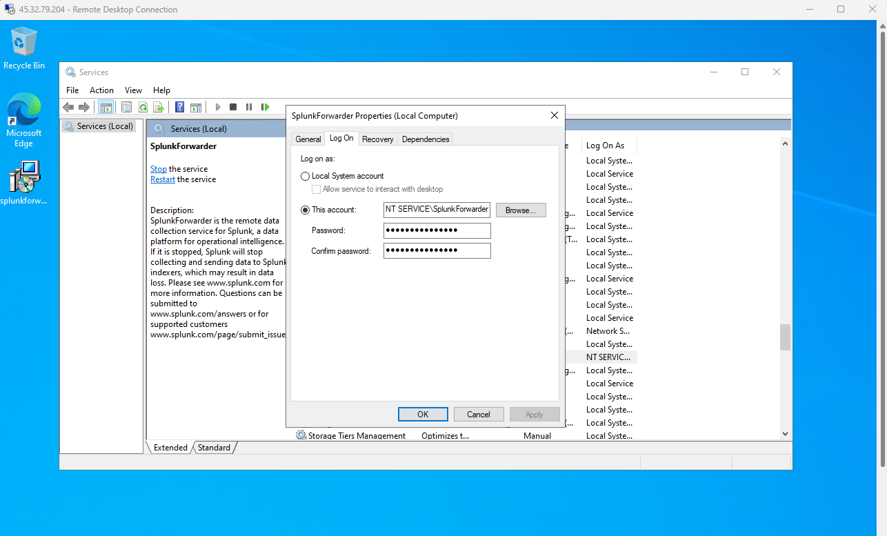

### Step 10: Troubleshooting Initial Event Ingestion

After configuring the forwarder, I searched the custom index:

```spl
index=sharp-ad
```

The first search returned **0 events**, showing that the forwarding pipeline was not working yet.

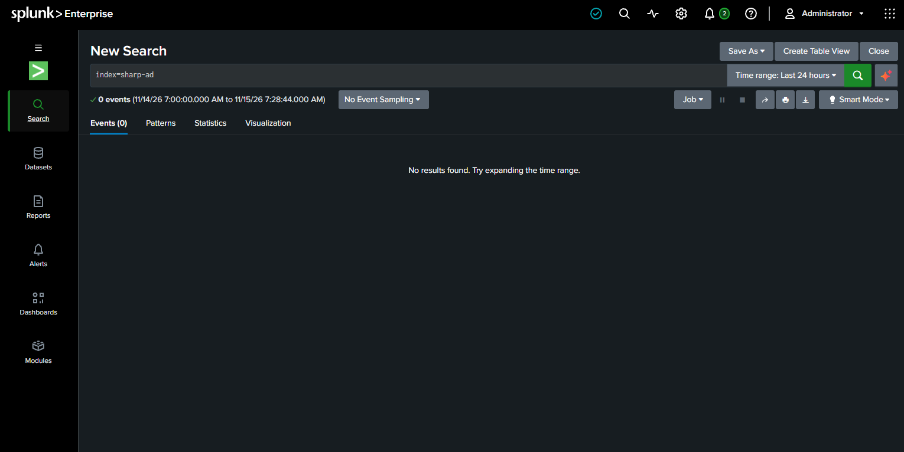

### Step 11: Verifying Initial Event Ingestion

After continuing the configuration and troubleshooting process, events began appearing in `sharp-ad`.

The first successful search showed more than **1,000 Windows Security events**.

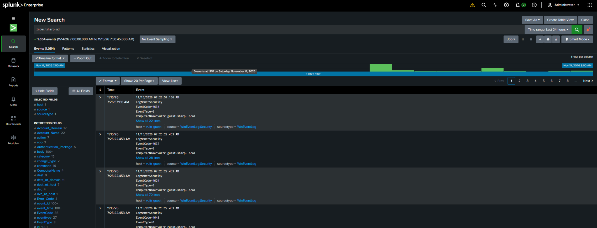

### Step 12: Troubleshooting the Domain Controller Forwarder

While installing the Universal Forwarder on the Domain Controller, I entered the Domain Controller's VPC address, `10.5.96.4`, in the setup screen instead of the Splunk server's VPC address.

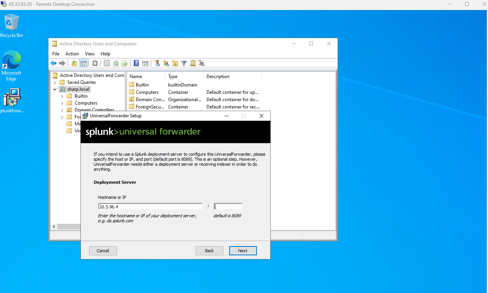

After installation, I corrected the forwarding target from the command line. I removed the incorrect destination and added the Splunk server at `10.5.96.5:9997`.

```powershell
& "C:\Program Files\SplunkUniversalForwarder\bin\splunk.exe" remove forward-server 10.5.96.4:9997
```

```powershell
& "C:\Program Files\SplunkUniversalForwarder\bin\splunk.exe" add forward-server 10.5.96.5:9997
```

The Domain Controller's local configuration directory contained the forwarder configuration files, including `inputs.conf` and `outputs.conf`.


I restarted the SplunkForwarder service so the corrected configuration would take effect.

```powershell
Restart-Service SplunkForwarder
```

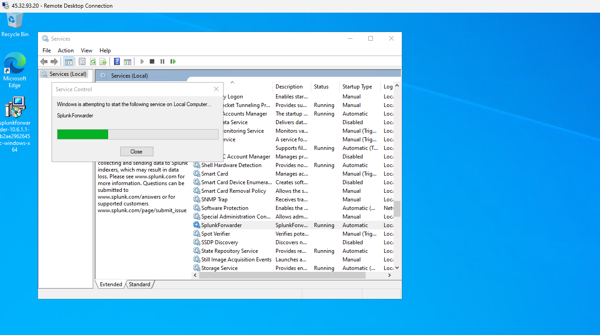

This troubleshooting step confirmed how an incorrect destination can prevent Windows telemetry from reaching the Splunk server.

### Step 13: Verifying Both Windows Hosts in Splunk

After correcting the forwarding destination, I searched `sharp-ad` again.

Splunk showed **1,208 events**, and the `host` field contained both Windows systems:

- `vultr-guest`
- `sharp-ADDC01`

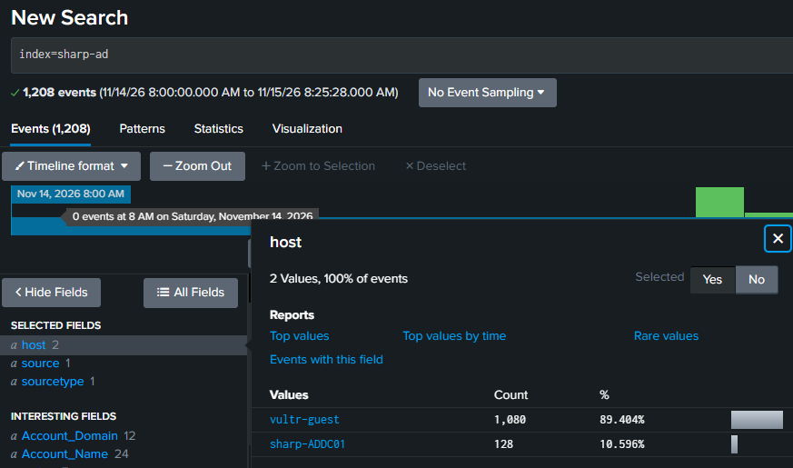

This confirmed that both Windows systems were forwarding event data successfully.

### Step 14: Researching Successful Windows Logons

With telemetry flowing into Splunk, I focused on Windows authentication events.

Event ID **4624** represents a successful account logon.


I also reviewed Windows logon types to understand which events were relevant to Remote Desktop activity.

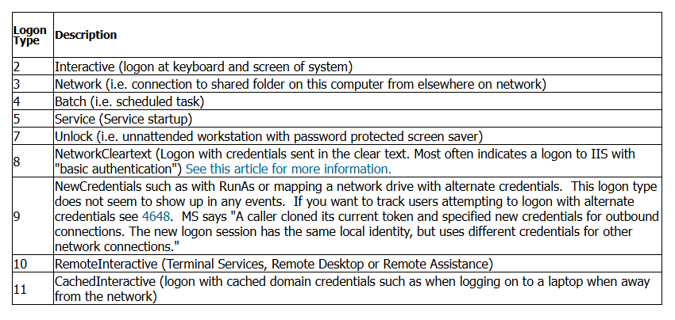

Relevant logon types included:

- **2 — Interactive:** Local console login
- **3 — Network:** Authentication over the network
- **7 — Unlock:** Unlocking an existing Windows session
- **10 — RemoteInteractive:** Remote Desktop or Terminal Services login

For RDP detection, **Logon Type 10** is the most relevant.

### Step 15: Searching Successful Authentication Events

I searched for successful authentication events using Event ID 4624:

```spl
index=sharp-ad EventCode=4624
```

The query returned **259 successful logon events**.

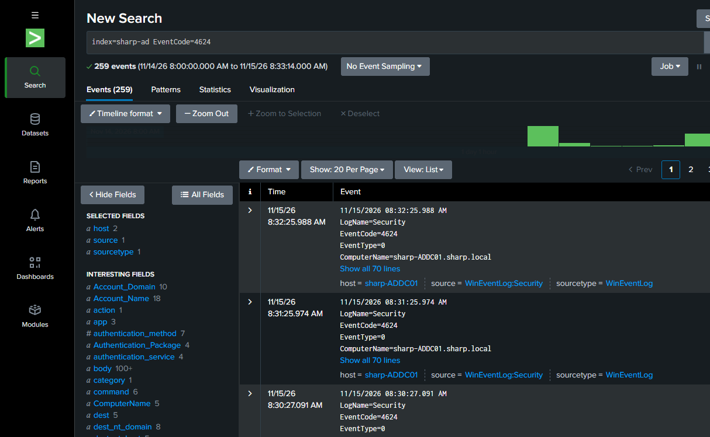

### Step 16: Filtering Relevant Logon Types

I narrowed the search to Logon Types **7** and **10**:

```spl
index=sharp-ad EventCode=4624 (Logon_Type=7 OR Logon_Type=10)
```

The filtered search returned **9 events**.

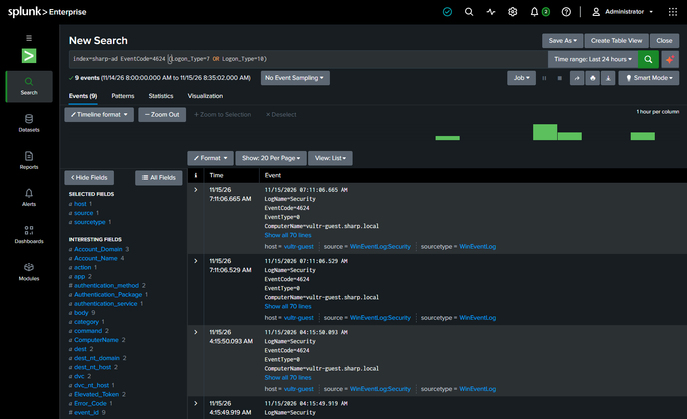

### Step 17: Inspecting a Successful Logon Event

I opened one of the events and reviewed the raw Windows Security data:

```text
Account Name: jsmith
Account Domain: SHARP
Logon Type: 7
```

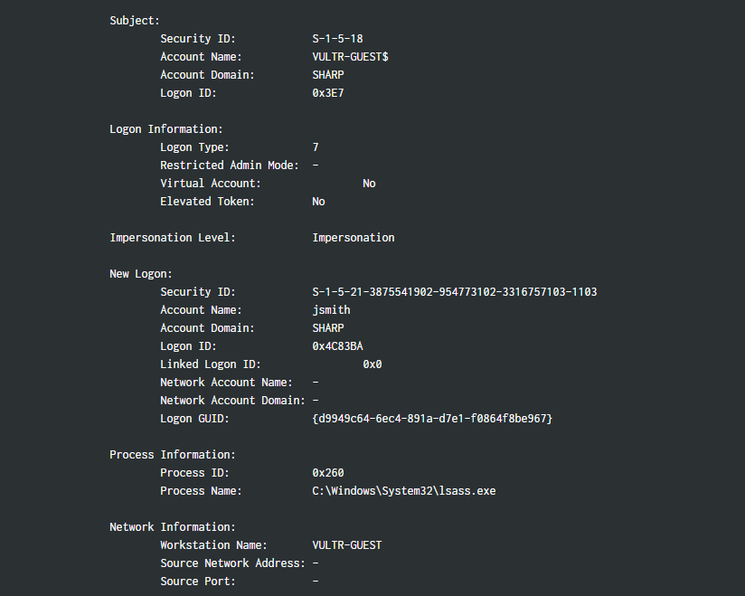

This event was a workstation unlock rather than a new RDP session, which helped reinforce the difference between Event ID 4624 logon types when building detection logic.

### Part 4: Results

During this phase, I:

- Deployed Splunk Enterprise on Ubuntu
- Configured Splunk Web access on TCP port 8000
- Installed the Splunk Add-on for Microsoft Windows
- Enabled Splunk receiving on TCP port 9997
- Installed Splunk Universal Forwarders on the Windows systems
- Configured Windows Security event collection
- Created and used the `sharp-ad` index
- Troubleshot an incorrect forwarding destination on the Domain Controller
- Restarted the SplunkForwarder service after correcting the destination
- Verified event ingestion from both Windows systems
- Investigated Event ID 4624 authentication activity
- Filtered Logon Types 7 and 10
- Distinguished workstation unlock activity from Remote Desktop logons

---

## Part 5: Shuffle SOAR, Slack Alerting & Analyst Approval

### Overview

In the final phase, I connected the Splunk detection workflow to Shuffle SOAR and Slack so authentication detections could generate external notifications and reach an analyst for review.

The completed workflow supports:

- Splunk detection alerts
- Shuffle webhook ingestion
- Slack security notifications
- Email-based analyst approval or rejection

### Step 1: Creating the Shuffle SOAR Workflow

I created a Shuffle workflow named `sharp-AD-Project-2.0` and added a webhook trigger named `Splunk-Alert`.

The webhook serves as the entry point for alert data coming from Splunk.


### Step 2: Connecting the Splunk Alert to Shuffle

I updated the Splunk alert:

```text
sharp-Unauthorized-Successful-Login-RDP
```

and added a **Webhook** action using the URL generated by Shuffle.

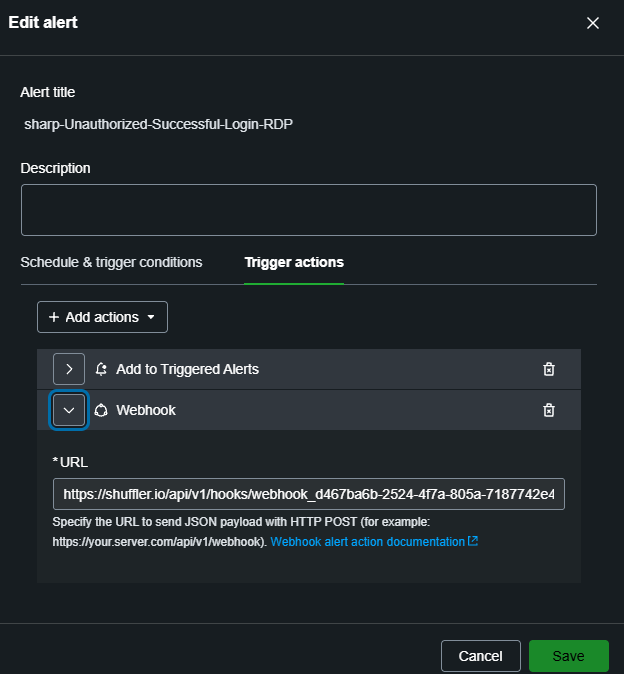

### Step 3: Verifying Splunk Events Inside Shuffle

After starting the Shuffle webhook, I triggered the Splunk detection and verified that Shuffle received the alert data.

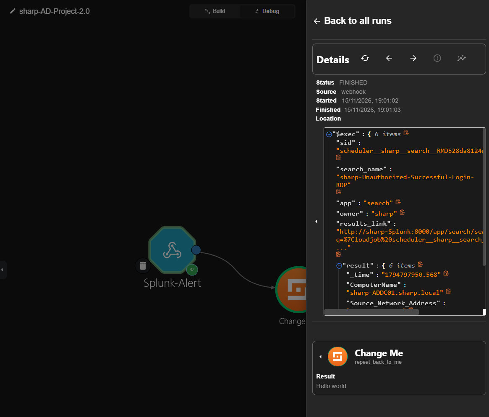

This confirmed that the **Splunk SIEM → Shuffle SOAR** connection was working.

### Step 4: Configuring Slack Incoming Webhooks

I created a custom Slack application named `sharp-soc-alerts` and enabled **Incoming Webhooks**.

This gave Shuffle an HTTP endpoint for sending security notifications into Slack.

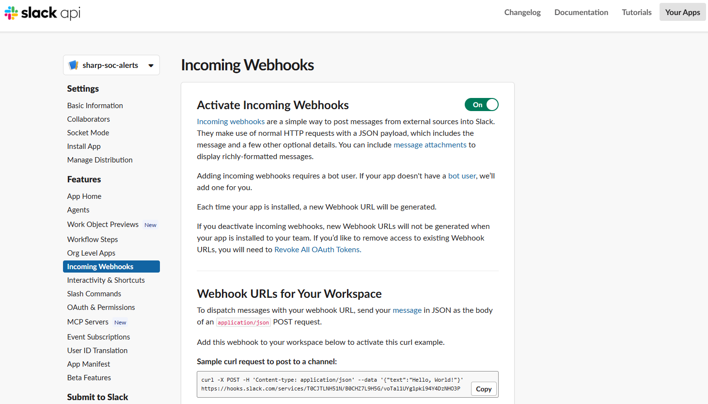

### Step 5: Adding Slack Notification Logic to Shuffle

Inside Shuffle, I added an HTTP action after the `Splunk-Alert` webhook. The action sends a POST request to the Slack Incoming Webhook whenever an alert enters the workflow.

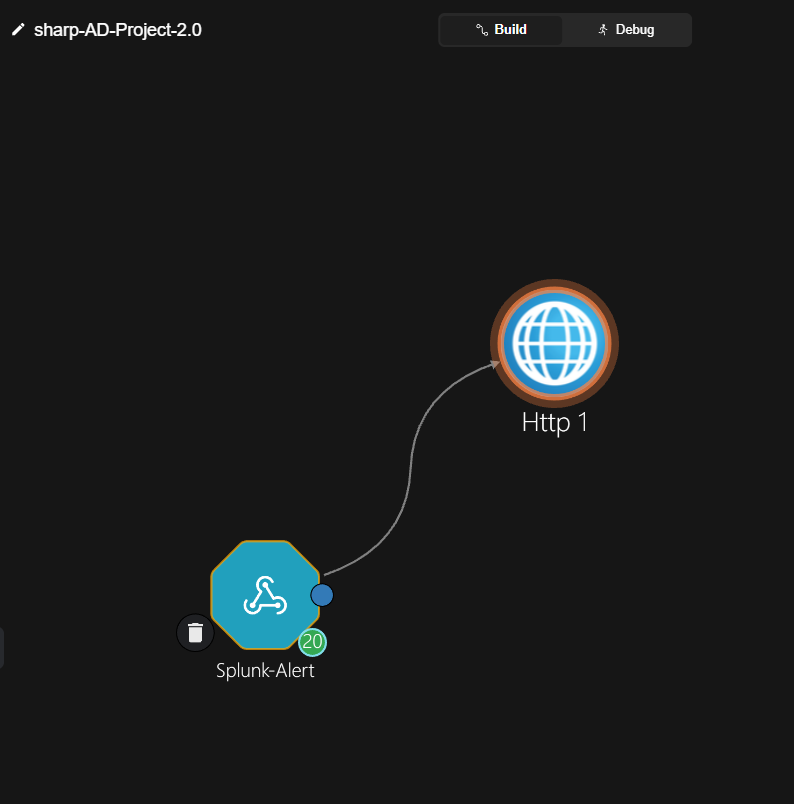

I first tested the connection with a basic notification.

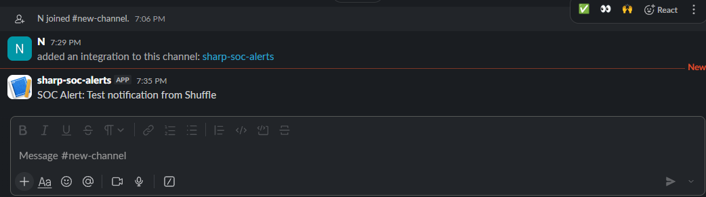

The Shuffle HTTP action returned **200**, confirming that Slack accepted the request.

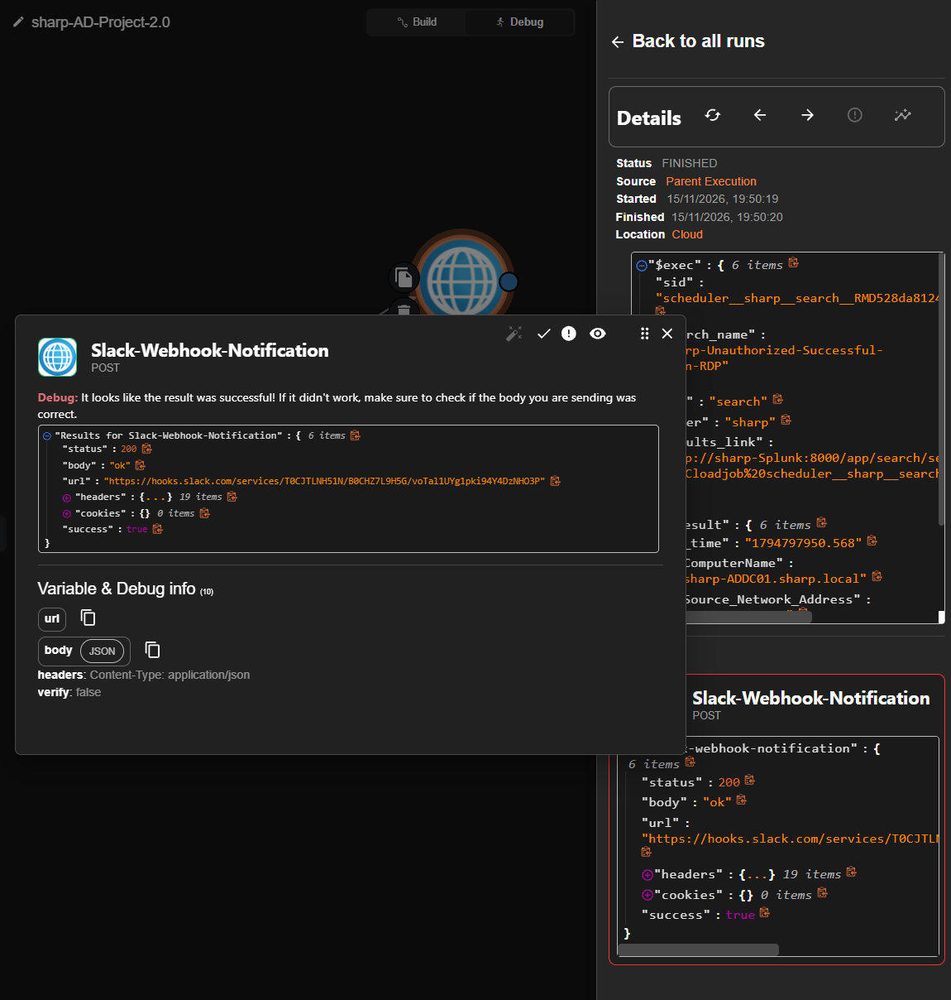

### Step 6: Building a Structured SOC Alert

After confirming connectivity, I formatted the Slack message into a more useful security notification.

The alert included available detection context such as:

- Source IP address
- Affected host
- Logon type
- Event count
- Detection rule name

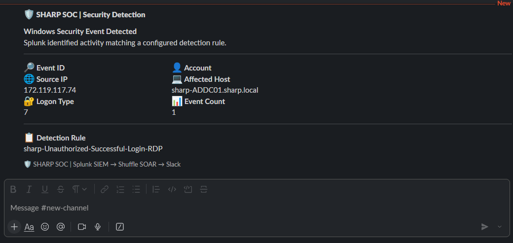

### Step 7: Adding Human-in-the-Loop Analyst Approval

I added a **User Input** action after the Slack notification.

The workflow now follows this path:

```text
Splunk Alert
    |
    v
Shuffle Webhook
    |
    v
Slack Notification
    |
    v
User Input
```


The User Input action sends an email asking the analyst to review the detection.

### Step 8: Testing the Analyst Approval Email

I successfully received the Shuffle approval email containing the security event details.

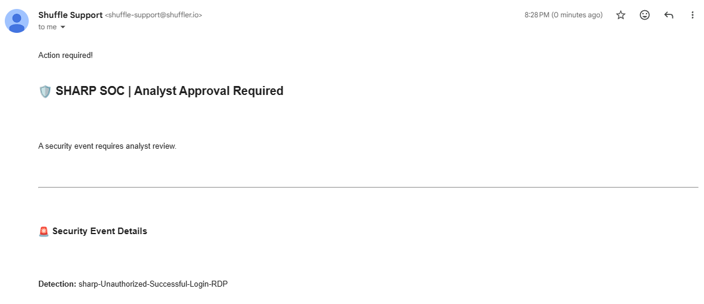

The analyst could respond with one of two options:

- **TRUE:** Approve
- **FALSE:** Reject


This confirmed that the workflow could deliver a detection to an analyst and collect a decision through email.

### Step 9: Final SOAR Workflow

The final implemented Shuffle workflow contains three primary components:

```text
Splunk-Alert
      |
      v
Slack-Webhook-Notification
      |
      v
User Input
```


### Detection Configuration

The Splunk detection used for this workflow was:

```text
sharp-Unauthorized-Successful-Login-RDP
```

During testing, the search monitored Event ID `4624` and focused on Logon Types `7` and `10`.

To reduce duplicate notifications, I narrowed the search window and configured the alert to trigger once per search.

### Final Workflow Architecture

```text
Windows Security Events
        |
        v
Splunk Universal Forwarder
        |
        v
Splunk Enterprise SIEM
        |
        v
Splunk Detection Alert
        |
        v
Shuffle SOAR Webhook
        |
        v
Slack Security Notification
        |
        v
Shuffle User Input
        |
        v
Analyst Approval / Rejection
```

### Part 5: Results

By the end of this phase, I had:

- Created a Shuffle SOAR workflow
- Configured a webhook trigger to receive Splunk alerts
- Connected the Splunk detection to Shuffle
- Verified that Shuffle received Splunk event data
- Created a custom Slack application with Incoming Webhooks enabled
- Added Slack notification logic to the Shuffle workflow
- Successfully tested Slack delivery
- Built a structured SOC security alert
- Added a User Input action for analyst review
- Successfully received analyst approval emails
- Implemented TRUE and FALSE analyst decision options
- Completed the workflow through analyst approval and rejection

---

## Final Project Outcome

This project gave me hands-on experience building a small SOC lab from the ground up and connecting the infrastructure, logging, detection, automation, and analyst review pieces into one workflow.

The completed environment includes:

- Active Directory infrastructure
- Windows endpoint telemetry
- Splunk SIEM log ingestion
- Authentication detection logic
- Shuffle SOAR automation
- Slack security notifications
- Analyst approval and rejection workflows

The final result is a functional detection and analyst review pipeline that collects Windows Security events, identifies targeted authentication activity, sends alerts through Shuffle and Slack, and routes detections to an analyst for an email-based decision.
